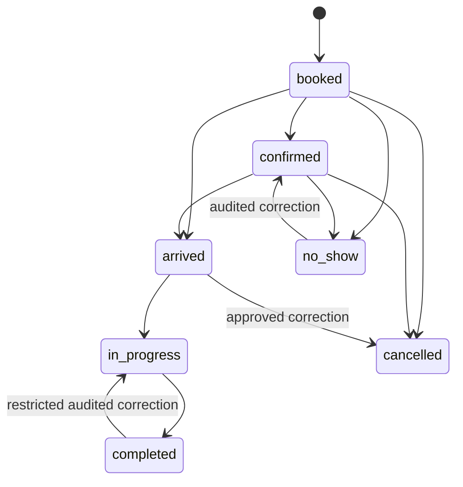
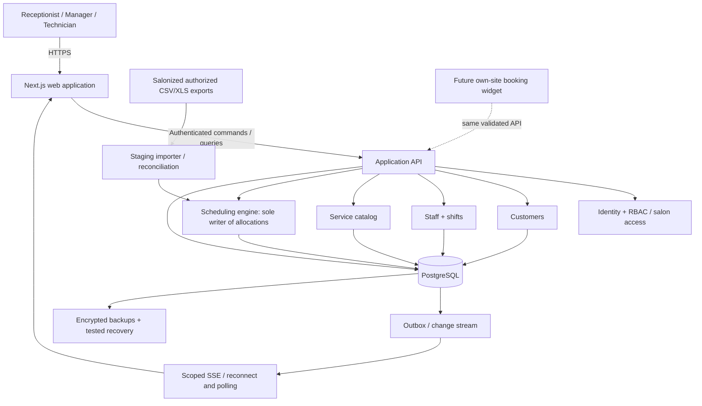
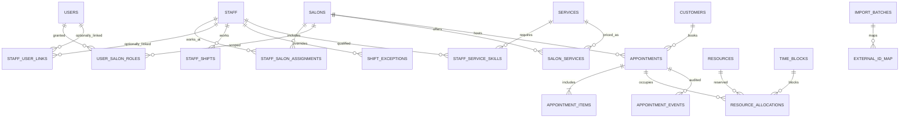
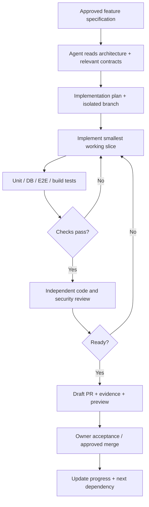

# NAIL SALON BOOKING PLATFORM
## Master Product & Engineering Architecture Blueprint

**Version 2.0 — 7 November 2026**  
**Status:** Proposed technical and product design; no code or tests have been executed.  
**Audience:** Product Owner, Cursor Project Coordinator, UI/UX, frontend, backend, QA, security and DevOps engineers.  
**Product:** An independently owned, internal-only booking platform for Jeannie Nagelstudio, Juliet – Salon de Beauté and a planned Heide salon.

> **North-star objective** — The software is successful only when receptionists can run real salon booking operations confidently without relying on Salonized for internal appointments. Documentation, visual mockups, agent orchestration and code-generation volume are supporting work—not the deliverable.

> **Scope boundary** — Scheduling, staff, customer and service administration are the product. No online payments, POS, invoices, inventory or payroll in the initial release. A first-party customer booking widget is an optional subsequent channel using the same scheduling engine.

---

## Executive decision memo

**We will build a modular monolith** using Next.js, TypeScript, React, PostgreSQL, an explicit domain-level booking engine, and an interchangeable staff-calendar UI. A centralized database will coordinate the salons. All writes affecting occupied time will be validated and committed by a single scheduling service in transactions, enforced by PostgreSQL overlap constraints. A user can interact with the system using the calendar, a customer profile, or a future public widget, but none may bypass booking rules.

The immediate engineering goal is **one complete, durable vertical slice**: select an open technician/time slot; choose an existing customer or walk-in; select a service; save; see the committed booking across devices; and safely edit, move or cancel it. The launch goal adds real staff rosters, access controls, imports, audit, backups, staff training and a resolved Treatwell operational plan.

**Top architecture decisions:**

| Topic | Proposed decision | Justification |
|---|---|---|
| Product type | Private internal web application, single business deployment | Avoid public SaaS complexity |
| Composition | Modular monolith, one repo, one main database | Easier testing, upgrades and AI coordination |
| Frontend | Next.js App Router, React, TypeScript, Tailwind CSS, shadcn/ui | Standard, maintainable toolchain |
| Calendar | Replaceable adapter; DayPilot Lite and React Big Calendar must pass a spike | Tablet capability and 20-column density cannot be assumed |
| Backend | Validated HTTP endpoints and server-only domain services | Consistent calls for every UI/channel |
| Persistence | PostgreSQL with SQL GiST exclusion constraints | Database-level protection against overlapping exclusive time |
| Data access | Drizzle ORM for standard queries; explicit SQL migrations where needed | Direct visibility into PostgreSQL features |
| Identity | Maintained, session-based authentication; employee ≠ login identity | Reliable scoped user access |
| Real-time | Database-backed change/outbox events + SSE with polling fallback | Prompt visibility; database remains authoritative |
| Delivery | GitHub PRs, CI, Cursor specialists, human approval gates | Reviewable, independently verifiable work |
| Go-live | Pilot, import reconciliation, verified restore, Treatwell transition decision | Reduce real booking losses |

### Definition of success (business acceptance)

The Owner approves production only after: (1) receptionists can complete **all critical daily booking workflows**; (2) two concurrent conflicting requests cannot double-book a technician; (3) shared staff cannot be scheduled in different salons simultaneously; (4) all upcoming appointments reconcile with the cutover source; (5) the calendar remains usable with 20 employees; (6) failed network requests and restarts do not lose accepted appointments; (7) data access, backups and a restore have been verified; and (8) the Treatwell channel has an explicitly tested operating procedure.

### Non-goals

Do **not** build an imitation of Salonized's internal implementation, reuse its visual assets, copy proprietary code, integrate online payment processing, act as a point-of-sale system, manage invoices or tax books, provide employee payroll, become a third-party SaaS marketplace, or claim a Treatwell API integration without verification.

---

# PART I — PRODUCT DISCOVERY AND REQUIREMENTS

## 1. Business context and operational constraints

- **Current operation:** Jeannie Nagelstudio and Juliet – Salon de Beauté in Hamburg; future third location in Heide.
- **Team:** Approximately 15–20 initially, increasing later; some technicians may work at multiple locations.
- **Current dependencies:** Salonized (calendar/customer/operations) and Treatwell (marketplace bookings and Salonized integration).
- **Platforms:** Desktop browser primary, iPad important, phone for manager and limited technician workflows.
- **Localization:** German initially; `Europe/Berlin`; Monday-first weeks; `DD.MM.YYYY`; 24-hour time; EUR; optional English and Vietnamese later.
- **Primary workflow:** Click an empty technician/time cell → customer → services → Save → synchronized calendar.
- **North-star interaction metric:** Returning customer whose treatment is known can be booked in **under 15 seconds**, tested with staff and a prepared data set; not an unconditional performance guarantee.
- **Owner objective:** Reduce recurring fees and supplier dependency **without weakening actual operational reliability**.

### Explicit assumptions until verified with salon staff

1. Each salon has an internet connection suitable for a cloud-hosted web application.
2. Most treatments occupy a technician continuously throughout their booked duration at launch.
3. Staff roles may differ by salon and some technicians will not have login accounts.
4. A receptionist may create appointments outside normal opening hours only with authorized override and a recorded reason.
5. Customers may be shared between salons only when the operating legal entities and privacy arrangements permit it. Default access is salon-scoped until validated.
6. Importable Salonized data formats will be determined from real exports; field names and IDs are **unknown** before inspection.
7. Treatwell two-way availability synchronization is **unverified**; it is a deployment blocker if the business continues to accept instant Treatwell bookings.

## 2. Personas, authority and daily jobs

| Persona | Must accomplish quickly | Limits |
|---|---|---|
| Owner | All salons, all calendars, staff, settings, quality, reports, audit and exports | Sensitive operations require reauthentication and audit |
| Salon manager | Run assigned salons, assign shifts, resolve conflicts, approved overrides | No access to unrelated salon or global identity secrets |
| Receptionist | Find/create customer; book, edit, move, cancel, block time; view service history as allowed | No mass export, security settings or cross-salon browsing by default |
| Technician | View own roster, appointment details needed for work; optionally update status | No arbitrary customer export, global staff data or owner settings |
| Future customer (not V1) | Book pay-at-salon time through a public widget | No admin access; rate limiting and verification |
| Dev/QA agent | Work on synthetic environments and assigned tickets | No production customer data, secrets, self-merge or production deployment |

A **staff member** is a bookable resource and may lack a login. A **user account** is an authenticated human and may be linked to a bookable staff record, but these are distinct database concepts.

## 3. Functional scope and release classification

**P0 = required for an internal production launch; P1 = shortly after launch unless an existing salon process makes it launch-critical; P2 = optional enhancements.**

| Domain | Feature | Priority | Business acceptance |
|---|---|---|---|
| Calendar | Multi-employee day, selected employee week, date navigation | P0 | Receptionist locates any shift/booking instantly |
| Calendar | Click empty slot, quick-create; resize; drag time/employee | P0 | Every accepted mutation persists; rejected mutation reverts |
| Calendar | Blocked intervals and unavailable shading | P0 | Out-of-shift, leave and breaks obvious |
| Calendar | 5–30 min display increments, filter, staff hide | P0 | Configured view persists per user/salon |
| Appointments | Create, details, edit, cancel, status/no-show, reason | P0 | Full audit and consistent allocation changes |
| Appointments | Ordered multiple services, sequential durations and snapshots | P0 | End time and staff allocation are correct |
| Appointments | Recurring series and exceptions | P1 | Single vs future changes correctly scoped |
| Staff | Cross-salon staff identities, qualifications, rosters, overrides | P0 | A person is never simultaneously occupied at two sites |
| Services | Categories, price, duration per salon, eligible staff | P0 | Historical bookings retain original snapshots |
| Customers | Search, create, contact details, history, notes, guest/walk-in | P0 | Booking never requires invented phone/email |
| Customers | Duplicates/merge, follow-up notes, prominent alerts | P1 | Merge retains history with audit |
| Multi-location | Salon switch, scoped rights, owner overview | P0 | No unauthorized cross-salon data access |
| Real-time | Multiple receptionists, updates and conflict feedback | P0 | Remote browser receives committed changes promptly |
| Administration | Employees, schedules, services, business hours, permissions | P0 | Manager can maintain daily business autonomously |
| Dashboard | Today's bookings, workers, customer counts, utilization | P1; earlier if receptionist depends on it | Metrics defined and source-backed |
| Notifications | Confirmation and reminders via email, opt-out controls | P1 / prelaunch if currently essential | No duplicate or unconsented communications |
| Waiting list | Staff-managed requests and contact actions | P2 or earlier if heavily used | Waiting list is not a reservation |
| Advanced resources | Rooms/tools, setup/process/finish service phases | P2 | Same allocation engine enforces exclusivity |
| First-party public booking | Own website widget, pay at salon | P2 | Shares booking engine and anti-conflict rules |
| POS/payments | Checkout, terminals, invoices, tips, financial ledger | Excluded | No code or dependencies |

**Feature parity principle:** "Like Salonized" means daily operational equivalence for the selected scheduling capabilities, not reimplementation of every Salonized product line. Verify the staff's actual current workflow before declaring an omitted module nonessential.

## 4. Specific Salonized research inputs

The public official documentation establishes the following references. These are **source-verified behavior descriptions**, not proof of our application's implementation:

1. **Appointment creation:** Clicking a time preselects it; customers may be found or created; one or several ordered services can be selected; an employee is selected and the appointment saved. The workflow also supports starting from a customer profile and looking up availabilities. [S1]
2. **Calendar configuration:** 15-minute default with 5–30-minute slots; appointment color by employee/service category; hide employees not scheduled; end buffers. [S2]
3. **Timetables:** Salon opening hours and individual employee hours, one-day exceptions vs future repeating patterns; rooms/tools may have separate schedules. [S3]
4. **Multi-location staff:** One identity can be linked to multiple locations, with rules assigning bookable hours to locations. [S4]
5. **Services:** Processing/finishing phases and buffers; room/equipment/extra staff resource constraints may apply. [S5]
6. **Recurring bookings:** Daily/weekly/monthly pattern and edit-one-vs-future behavior. [S6]
7. **Customers:** Merge duplicate customers, add notes and alerts. [S7]
8. **Waiting list:** Date/time preference, desired services, staff preferences and a follow-up workflow, not automatic booking. [S8]
9. **Exports:** Lifetime customer database, historical and deleted appointments, absences and treatment reports can be exported to CSV/XLS depending on selection. [S9]
10. **Treatwell:** Salonized documents Treatwell bookings appearing in Salonized; it does not demonstrate a supported custom-app integration contract. [S10]

### Mapping from the three user-supplied screenshots

- **Dashboard reference:** dark compact sidebar; center daily appointment agenda; right column includes quick start, today's notes, working employees, customer counts, utilization and waiting list. Exclude the payment advert and unused checkout cards.
- **Calendar reference:** dark navigation; a slim top toolbar (date, day/week, employees, display filters, search, create); multi-technician columns; an all-day/waiting-list row; a dense 15-minute vertical grid; pastel bookings; hatched unavailable periods; existing bookings show customer, treatment and start/end; horizontal scrolling is inevitable at 20 staff.
- **Settings reference:** primary left nav plus grouped secondary settings for General, Company, Calendar, Customers; preserve services, employees, absences, timetable, resources and calendar settings; remove billing, register, VAT, loyalty and marketing from V1.

These are **functional and layout references**. Use original iconography, brand identifiers, code and component design rather than copying proprietary graphic assets.

## 5. Core workflows and measurable acceptance

### Flow A — New booking from calendar

1. Staff opens a permitted salon and selects a date.
2. User clicks/taps an empty slot in a staff column.
3. Booking sheet preselects `salon_id`, `staff_id` and local start.
4. Customer lookup supports normalized phone/partial name; choose customer, create minimal new customer, or choose guest/walk-in.
5. Choose one or more services in order; display individual price and duration snapshots, staff eligibility, computed end time and conflict warnings.
6. User saves with an idempotency key and expected resource allocations.
7. Server validates identity, salon permission, service eligibility, location, shifts, leave, and all required exclusive resources.
8. One transaction commits appointment + service snapshots + resource allocations + audit + change event.
9. UI acknowledges only after authoritative success; other clients see the update.
10. If conflict: HTTP 409, keep the form, identify reason and suggest a fresh availability search.

### Flow B — Move or resize

1. User drags an appointment to another time/staff, or selects `Termin verschieben` for touch fallback.
2. UI displays tentative preview only; source record remains authoritative.
3. Client sends appointment ID, expected version, new start/staff and idempotency key.
4. Backend locks the affected resources, validates the new complete allocation set and either commits or rejects atomically.
5. On success, update the event version and live views; on rejection, revert card without losing appointment details.
6. A resize affecting service duration must explicitly show an override, not silently change the service catalog.

### Flow C — Cancel and no-show

- Cancel requires confirmation; optional reason; active resource allocations are released but appointment and audit remain.
- No-show changes status and retains historical resource occupancy unless manager explicitly corrects it in an audited workflow.
- A completed visit remains historical. Do not delete past allocations simply because time has passed.
- No-show emails are separate explicit operations; no accidental marketing messages.

### Flow D — Change employee schedule

- Manager edits hours or an absence.
- Backend identifies affected future appointments before the change.
- If any are invalidated, manager must resolve/move them or explicitly apply a safe policy before schedule change commits.
- The same staff resource lock is used as booking transactions to prevent a race between schedule edits and new bookings.
- Record who changed the timetable and why.

### Flow E — Customer history and one-click rebook

- Search and open a customer → visit history (salon-scoped rights) → choose recent service(s) → Create booking prefilled with treatment/staff preference, subject to **current** price, duration, availability and qualifications.
- Snapshot the chosen current details at save. Historical snapshots are immutable.

### Flow F — Multi-location staff

- A single staff identity can have shifts at different locations.
- The same exclusive staff resource is allocated regardless of location.
- A cross-salon move checks location assignment, travel feasibility policy and absence/shift conditions; no simultaneous occupancy.

## 6. Booking lifecycle and status model



**Rule:** Appointment status and resource occupancy are related but not the same. Occupancy is enforced by `resource_allocations.active` and controlled domain transitions. Cancellations release allocations; corrections retain audit history. State transitions not drawn above require a deliberate domain rule and appropriate authorization.

---

# PART II — UX AND DESIGN SYSTEM

## 7. Information architecture and page map

**Primary navigation:** `Kalender`, `Übersicht`, `Kunden`, `Team`, `Leistungen`, `Einstellungen`.

**Context:** A fixed salon selector stays near the top of the shell. Owner can choose a salon or authorized consolidated view. `Einstellungen` has second-level navigation:

- **Allgemein:** company/salon preferences, users and permissions, data exports.
- **Salon:** locations, opening hours, resources (later).
- **Team:** employees, skills, timetable, absences.
- **Kalender:** slot and color settings, booking policy, blocks.
- **Kunden:** data fields, notes permissions, retention controls.

**Excluded initially:** Register, invoices, product stock, checkout, discounts and payment advertisements. Preserve placeholders only where a documented future module truly requires them.

## 8. Primary calendar UX contract

```text
+------------------+--------------------------------------------------------------------------+
| [Business/Salon] | <  Sa 07.11.2026  >  Heute  [Tag | Woche]  [Personal v]  Suche  +Termin |
|------------------+---------+--------------+--------------+--------------+---------+
|  Kalender        | Time    | Lena         | Jennifer     | Julia        | ...     |
|  Uebersicht      |         | 10-20        | 10-20        | 12-20        |         |
|  Kunden          | 10:00   | Gel / Rosa   |              | /unavailable |         |
|  Team            | 10:15   |              | Shellac      | /unavailable |         |
|  Leistungen      | 10:30   |              | A. Mueller   |              |         |
|  Einstellungen   | 10:45   | [+]          |              | Manikuere    |         |
|                   | 11:00   |              | Pause ////   | M. Fischer   |         |
+------------------+---------+--------------+--------------+--------------+---------+
                         [On click, right-side booking sheet]
                         Customer search  [new customer / walk-in]
                         Service(s), ordered + duration + price
                         Technician + local start/end + notes
                         [Check availability] [Save appointment]
```

### Screen behavior and layout measurements (design targets, not final pixel specifications)

- Desktop sidebar: 200–240px expanded, 56–72px collapsed. Calendar takes remaining width.
- Time ruler: approximately 64–76px wide; staff columns generally 150–200px each, user-adjustable where supported.
- Support horizontal calendar scrolling; **never shrink 20 staff columns** to unreadable widths. Staff headers remain sticky relative to the scroll container.
- Initial 15-minute grid; choices of 5/10/15/20/30 minutes. Time range defaults to salon hours with optional padding.
- Daily calendar for all chosen staff; weekly view for **one selected staff member** or a filtered subset with a clearly documented limit.
- Current-time indicator, blocked periods/absences, lunch gaps, pending drag preview, load/failure/offline states.
- Appointment visual: time, customer, service; text truncation with accessible detail; pastel by treatment category or staff; hatch unavailable slots; status indicated by text and/or icon in addition to color.
- When a service title is long, use two-line truncation; full details available by opening the booking.
- Native scrolling must not accidentally trigger drag on an iPad. If drag/touch proves unreliable, use **tap → edit → change time/technician** as first-class fallback.
- Use original branding and accessible contrast. Do not copy Salonized art/assets.

### Key components and responsibilities

| Component | Input | Output/interaction | Owner |
|---|---|---|---|
| `SalonSwitcher` | authorized salons | active location context | Frontend/Auth |
| `CalendarToolbar` | date, mode, filter | navigation state | Frontend |
| `StaffCalendarAdapter` | read-only slots, bookings, blocks | selection/drag intentions | Frontend |
| `AppointmentCard` | safe display summary | open details | Frontend |
| `BookingSheet` | draft, customer, services | validated booking command | Frontend |
| `AvailabilityIndicator` | candidate slots and errors | actionable conflict messaging | Frontend |
| `CustomerPicker` | scoped search | selected/created customer | Frontend |
| `ServicePicker` | available treatments | ordered service items | Frontend |
| `BookingDetailsSheet` | committed appointment/version | edit/cancel/reschedule | Frontend |
| `ShiftEditor` | staff weekly plan | schedule change command | Frontend |

### Interaction requirements

- Save disabled while request in flight; duplicate click safely handled by idempotency key.
- Form draft is preserved on 409/422 and temporary network error.
- Long-running operations show feedback but must not appear completed until server acknowledgment.
- On stale appointment `version`, show refreshed latest details and ask user to resolve changes; do not silently overwrite.
- Repeatedly pressing back/forward changes calendar date predictably; locale and scroll restoration tested.
- Screen reader roles/labels; tab order; strong visible focus; keyboard alternatives for drag actions.

## 9. Calendar component selection spike

**Do not choose a library based on screenshots or branding.** Run reproducible prototypes for these candidates:

| Criterion | DayPilot Lite Resource Calendar | React Big Calendar |
|---|---|---|
| License | Apache 2.0 for Lite | MIT |
| Vertical columns per technician | Explicitly supported | Resource views documented; verify layout with chosen version |
| Time click, drag and resize | Documented in Lite | Addon and adapter; inspect real implementation |
| Styling | Themes and custom event content | CSS/custom event components |
| Touch on vertical resource calendar | **Listed as Pro feature on official Lite/Pro comparison** | Must test real iPad interactions and fallback |
| Large 20-column grid | Needs actual desktop/iPad test; some performance features Pro | Needs horizontal scroll/sticky header work |
| Selection gate | Must pass tests; no early lock-in | Must pass tests; no early lock-in |

**Reference:** DayPilot's React comparison distinguishes its horizontal Scheduler from the **vertical Resource Calendar**; do not assume touch support in one component implies touch support in the other. [T1]

**Prototype acceptance:** 20 synthetic staff; at least 250 bookings across a representative day/week; drag cross-staff, resize, click/create, blocked-shift styling, German localization, Safari on physical iPad, Chrome on desktop, error rollback, long labels, keyboard alternative, 2-hour scroll range and session stability. Write measured observations to `docs/decisions/ADR-004-calendar-library.md`.

---

# PART III — SYSTEM AND CODE ARCHITECTURE

## 10. System context and deployment boundary



**Why a modular monolith?** It centralizes transactions and reduces coordination failures. Clear module interfaces let Cursor specialists work independently without microservices, distributed consistency, several databases or a message broker during V1.

## 11. Module boundaries and dependency rule

| Module | Owns | May call | Must not do |
|---|---|---|---|
| Identity | login sessions, users, permissions | user tables | alter appointments directly |
| Salon | location settings, opening hours | identity policy, salon tables | decide exclusive allocations |
| Staff | bookable workers, salon links, skills, shifts, absence | salon, database | bypass scheduling service for conflicting changes |
| Services | catalog, prices, duration, qualification | salon, staff metadata | mutate past booking snapshots |
| Customers | contact info, controlled notes, search, merge | identity policy | directly occupy staff time |
| Scheduling | availability, create, edit, move, cancel, allocate, version, status | all reference modules + transaction | trust browser as authoritative |
| Calendar query | assemble read model for views | scheduling, shifts, customer summaries | change booking data |
| Audit | immutable append-only operational changes | actor/context | become a mutable source of truth |
| Import | stage/preview/map/reconcile approved exports | scheduling and customer APIs/services | write raw imported bookings bypassing invariants |
| Notifications (later) | templates, outbox, delivery outcomes | booking event stream | confirm booking before DB commit |
| Reporting (later) | derived KPIs and snapshots | authorized read models | treat appointment price as payment |

**One-way data principle:** UI → API → application services → database. Only scheduling domain services may create, reschedule or release exclusive resource allocations. Other modules may request these operations via explicit commands.

### Proposed source layout

```text
nail-salon-booking/
  apps/
    web/
      app/                 # route segments and authenticated pages
      components/          # shared UI only
      features/calendar/   # adapter + cards + date controls
      features/booking/    # create/edit sheets and hooks
      features/customers/
      features/staff/
      features/services/
  packages/
    domain/
      scheduling/          # pure rules and typed interfaces
      customers/
      staff/
      services/
      authz/
    db/
      schema/
      migrations/
      queries/
    contracts/
      commands/
      events/
      api/
    ui/                    # design tokens/shared components if worthwhile
  docs/
    PRODUCT.md
    ARCHITECTURE.md
    UI_SPEC.md
    API_CONTRACTS.md
    DECISIONS.md
    RUNBOOK.md
    risks.md
    feature-specs/
  .cursor/agents/
  .github/workflows/
  AGENTS.md
```

This is a **logical directory plan**, not an instruction to create many npm workspaces before justified. Start with one Next.js app and in-repo module folders if repository ergonomics are better; isolate the domain/API contracts regardless.

## 12. Stack decision and change policy

- **TypeScript strict mode** across app, domain and migrations.
- **Next.js / React:** secure app shell, role-aware pages, server API route handlers; keep actual booking logic server-only.
- **Tailwind/shadcn/ui:** styling, forms, dialogs, customer lists and secondary settings.
- **PostgreSQL:** definitive source of truth; timestamps as `timestamptz`, ranges with `tstzrange`; proper unique/index constraints.
- **Drizzle:** typed CRUD; explicit SQL migrations for advanced constraints. Database schema decisions must be version-controlled.
- **Validation:** Zod at request boundaries and server-side domain validation; never assume UI forms already checked inputs.
- **Authentication:** pick a maintained session/cookie implementation after a focused security spike; require same-site/secure cookie settings, CSRF threat review, password reset, MFA for owner, timeout and revocation.
- **Events:** transactional outbox/change log, SSE with reconnect and polling fallback. Push notifications contain IDs/scopes, not rich customer data.
- **Testing:** Vitest for domain rules, PostgreSQL integration tests for constraints/concurrency, Playwright for staff workflows, accessibility checks and target-browser testing.
- **Deployment:** containerized service in an EU region, managed/adequately backed-up PostgreSQL, TLS, isolated staging and production secrets.

**Versioning:** Pin dependency major versions during a milestone; update deliberately with release notes and CI. No "latest everywhere" upgrades without tests.

## 13. API design conventions

All endpoints are authenticated unless explicitly designated public in a future release. Authorization is always checked by resolved **session + roles + salon scope** on the server; front-end hiding is only UX.

Standard write command metadata:

- `requestId` for traceability.
- `Idempotency-Key` to safely retry create/move after a network interruption.
- `expectedVersion` for updates to existing appointments.
- Explicit salon, staff and time identifiers validated against auth scope.
- `occurredAt` determined on server for events; client time is never an authority for audit.

| Route | Semantics | Core rules |
|---|---|---|
| `GET /api/salons` | authorized salon list | only permitted sites |
| `GET /api/calendar?salonId&from&to&staffIds` | range-scoped read model | safe customer summary only |
| `GET /api/availability?salonId&serviceIds&staffId&date` | availability hints | not final booking authorization |
| `POST /api/appointments` | book visit | atomic + idempotent |
| `GET /api/appointments/:id` | details | salon/role scope |
| `PATCH /api/appointments/:id` | edit non-time fields and valid status | version check |
| `POST /api/appointments/:id/reschedule` | atomically reallocate | version, locks, 409 |
| `POST /api/appointments/:id/cancel` | cancel + release allocations | audit + optional reason |
| `GET/POST/PATCH /api/customers` | scoped search/create/edit | phone normalization + PII controls |
| `GET/POST/PATCH /api/staff` | manage bookable staff | managed by permission |
| `GET/POST/PATCH /api/shifts` | staff working times | same booking concurrency locks |
| `GET/POST/PATCH /api/absences` | breaks/leave | impact analysis |
| `GET/POST/PATCH /api/services` | catalog | preserve historical snapshots |
| `POST /api/imports/preview` | parse + validate export | staging only, no data mutation |
| `POST /api/imports/:id/commit` | approved staged import | audited, idempotent, domain-safe |
| `GET /api/events` | scoped calendar invalidations | reconnect + replay/poll fallback |

### Example request/response contract: create appointment

```json
POST /api/appointments
Idempotency-Key: 38d9... (opaque client-generated value)
{
  "salonId": "uuid",
  "customerId": "uuid-or-null",
  "guestDisplayName": "Walk-in visitor",
  "startAt": "2026-11-09T13:00:00Z",
  "serviceItems": [
    {"serviceId":"uuid","staffId":"uuid","sequence":1}
  ],
  "notes": "Optional operational note"
}
```

Success `201`: appointment ID, generated `version`, start/end UTC, service snapshots, allocations and a `calendarRevision`. Conflict `409`: machine-readable code (`STAFF_OCCUPIED`, `STAFF_ABSENT`, `OUTSIDE_SHIFT`, `STALE_VERSION`, `RESOURCE_CONFLICT`), safe user message and candidate refresh timestamp. Validation `422`; authentication `401`; authorization `403`; rate limit `429`.

**No customer name or personal notes in URLs, cache keys or generic error logs.**

## 14. Database ERD (conceptual)



## 15. Data dictionary and invariants

### Organizational and user tables

| Table | Representative columns | Constraints |
|---|---|---|
| `salons` | id, name, timezone, address, status | unique stable ID; IANA time zone |
| `users` | id, login identity, active, auth metadata | unique normalized login email |
| `user_salon_roles` | user_id, salon_id nullable, role, effective dates | global owner role explicitly granted |
| `staff` | id, display_name, color, active | one human may span salons |
| `staff_user_links` | user_id, staff_id | optional; intentional mapping, not assumed |
| `staff_salon_assignments` | staff_id, salon_id, active_from/to | no invalid time periods |
| `salon_hours` | salon_id, weekday, local start/end, effective period | multiple segments permitted |
| `staff_shifts` | staff_id, salon_id, weekly segments, effective period | multiple segments; clear precedence |
| `shift_exceptions` | staff_id, salon_id, local_date, replacement segments/closed, reason | exception supersedes matching template |
| `time_blocks` | id, resource_id, start/end UTC, kind, author, reason | absence and closed periods not booked |

### Customer, service and appointment tables

| Table | Representative columns | Constraints |
|---|---|---|
| `customers` | id, first/last, display_name, phone_e164 nullable, email normalized nullable, consent/retention metadata | minimal PII; no fabricated phone |
| `customer_notes` | id, customer_id, creator, text, visibility, created_at | role-scoped; avoid collecting health details unnecessarily |
| `service_categories` | id, name, color | active/archive rather than history deletion |
| `services` | id, category_id, name, base_duration, active | current catalog only |
| `salon_services` | salon_id, service_id, price_cents, duration_minutes, active | location-specific; money as integer minor units |
| `staff_service_skills` | staff_id, service_id, optional duration override | staff qualification required where configured |
| `appointments` | id, salon_id, customer_id nullable, guest_display_name nullable, status, source, start_at/end_at UTC, version, notes, created_by | nonzero interval; source explicit; optimistic version |
| `appointment_items` | id, appointment_id, sequence, service_id, staff_id, actual start/end, snapshot_name, snapshot_price_cents, snapshot_duration_minutes | immutable historical snapshots |
| `resources` | id, kind (`staff`, later `room`, `equipment`), staff_id nullable, salon_id nullable | exactly one stable staff resource for a bookable human |
| `resource_allocations` | id, resource_id, owner_type, appointment_id or time_block_id, starts_at, ends_at, active | partial exclusion constraint; half-open intervals |
| `appointment_events` | id, appointment_id, actor_id, event_type, before/after summary, reason, timestamp, correlation_id | append only |
| `idempotency_records` | actor_id, endpoint, key, fingerprint, stored response, expiry | duplicate retries do not duplicate writes |
| `outbox_events` | sequence, aggregate_id, salon_id, type, timestamp, payload_minimal, delivered_at | transactional event visibility |
| `import_batches` | id, source, file_hash, status, counts, mapping, actor | staging and controlled approval |
| `external_id_map` | source, salon_id, external_entity_type, external_id, internal_id | unique per source identity; replay safe |

**Decisions reserved for implementation spec:** PostgreSQL `uuid` vs `bigint` key strategy; phone normalization library; privacy retention schedule; expected shift recurrence modeling and holiday calendar policy. Lock these in ADRs before migrations, not ad hoc during feature coding.

### SQL non-overlap protection (illustrative implementation contract)

```sql
CREATE EXTENSION IF NOT EXISTS btree_gist;

ALTER TABLE resource_allocations
  ADD CONSTRAINT allocation_positive_duration
  CHECK (starts_at < ends_at);

ALTER TABLE resource_allocations
  ADD CONSTRAINT active_resource_no_overlap
  EXCLUDE USING gist (
    resource_id WITH =,
    tstzrange(starts_at, ends_at, '[)') WITH &&
  ) WHERE (active);
```

This shows the core invariant: for any resource, **no two active allocations may overlap**. Actual schema also requires foreign-key ownership checks, indexes, allowed resource kinds, and migration/constraint tests. Adjacent intervals are allowed because ranges are `[start, end)`.

**Never enforce no-overlap only via SELECT-before-INSERT.** That approach races when simultaneous receptionists book the same time. The database constraint is the final authority.

## 16. Booking engine transaction algorithm

### Create

1. Authenticate caller; authorize salon/role; parse and validate command.
2. Check idempotency key and request fingerprint, returning the stored result for a true retry.
3. Resolve service catalog, salon-specific duration/price, staff skill and authorized location assignment.
4. Build ordered appointment items and all occupied intervals, including buffers. For V1 assume sequential, continuously staffed treatments. Later phase-based processing can create disjoint occupancy intervals.
5. Identify every affected exclusive resource; sort resource IDs in a stable order.
6. Start transaction; acquire transaction-scoped per-resource advisory locks (or documented equivalent) in stable order; use appropriate transaction isolation and retry strategy.
7. Re-check salon opening hours, current effective staff shifts, absences/blocks and service eligibility **inside the transaction under the same scheduling lock discipline**.
8. Insert appointment, snapshots and active allocations. PostgreSQL exclusion constraint rejects any overlap.
9. Append audit event, change/outbox event and idempotent result in the same transaction.
10. Commit; return appointment/version. Realtime publisher sends only after commit.

### Reschedule

- Load existing appointment with expected version; determine union of old and new resources; lock in stable order.
- Validate new time/services/staff and shift rules inside transaction.
- Update allocations consistently, preserve historical audit and increment version. If constraints fail, roll back **all** changes.
- A late competing edit returns stale-version 409; never perform last-write-wins silently.
- Publish change only after commit.

### Shift and leave edits

- Acquire **the same per-resource locks** as create/reschedule, so a concurrent schedule change cannot make a just-accepted booking invalid.
- Calculate which future committed bookings would be impacted.
- Reject or require a documented resolution/override procedure. A manager cannot unknowingly hide existing future bookings by closing a shift.

### Important nuances

- Appointments with several staff members allocate the corresponding **exact staff intervals**, not a single incorrect full-visit interval for everyone.
- Multiple-resource operations must be atomic. Do not commit half a treatment.
- Live update events are *notifications*, not the source of truth. Clients refetch after reconnect.
- Time calculations store unambiguous instants in UTC and render location-local time. Reject nonexistent/ambiguous local times at DST boundaries unless offset/disambiguation is explicitly supplied.
- A cancellation marks relevant allocations inactive and writes audit, never silently deletes the appointment.
- No-show and completed appointments preserve recorded history; historical occupied intervals are not simply recycled.

## 17. Availability algorithm

Candidate slot search is a **hinting read operation**, not a booking guarantee:

1. Compute salon open intervals for selected local date.
2. Intersect with staff effective shift intervals at the correct salon.
3. Remove absences, breaks and occupied allocations (plus buffers).
4. Remove time segments violating service qualification, sequence or future resource constraints.
5. Generate candidate starts at configured booking granularity (not necessarily the display-grid granularity).
6. Return results with a snapshot revision and reason codes for unavailable times.
7. Final create/reschedule must rerun authoritative checks in the write transaction.

**Do not blindly add 24 hours to the local date**: Germany's DST dates have different UTC lengths.

---

# PART IV — DATA, SECURITY AND OPERATIONS

## 18. Data protection and security architecture

- Limit customer fields to operationally necessary data. Customer notes and alerts can accidentally contain sensitive personal information; put them behind tighter permissions and encourage non-medical wording when possible.
- If separate salon legal entities share customer data, document the appropriate controller relationship, lawful basis and transparency before enabling cross-entity global records.
- Select EU-region application/database/backups; validate data processing agreements with hosting/email providers and any cloud coding agent processing real data.
- **No live Salonized exports, actual customer names, emails or phone numbers in AI/cloud development fixtures.** Use synthetic fixtures, sanitized exports and a separate protected migration environment.
- Enforce server-side authorization on every request, every search and every SSE subscription. Filter customer details and notes by role and salon.
- TLS, secure sessions, login rate limiting, owner MFA, strong password reset and session revocation.
- Account for CSRF, XSS, injection, insecure file upload and dependency supply-chain risks.
- Protect secrets in managed deployment secrets; never check `.env`, exports or production credentials into Git.
- Append-only audit trail for booking changes, bulk exports, customer merges, permissions and schedule overrides.
- Define a retention and deletion/export policy with counsel or a GDPR specialist; avoid false claims of legal compliance solely from code.
- Owner-accessible export, deletion requests and rectification flows must respect any applicable record-retention obligations.

### Authorization matrix (baseline)

| Operation | Owner | Manager (assigned salon) | Receptionist | Technician |
|---|---|---|---|---|
| View assigned salon calendars | All | Yes | Yes | Own permitted view |
| Create/move/cancel booking | Yes | Yes | Yes | No by default |
| Read basic operational customer details | Yes | Yes | Yes | Only minimum assigned appointment data |
| Read sensitive notes/alerts | Yes | Limited explicit permission | Limited explicit permission | No by default |
| Change staff shifts/absences | Yes | Yes | Limited time blocks if granted | Request-only |
| Change services/prices | Yes | Yes | No | No |
| Change user roles | Yes | No/global owner only | No | No |
| Bulk data export / import | Yes | Explicitly delegated | No | No |
| Review security audit | Yes | Scoped operations if delegated | No | No |

## 19. Multi-user consistency and offline behavior

- After successful DB commit, add a scoped outbox event; SSE or WebSocket delivers a lightweight invalidation to all authorized calendar sessions.
- Clients fetch the authoritative updated calendar slice; events are not trusted full-state replicas.
- Each calendar feed carries a monotonic revision or cursor; on SSE reconnect compare revisions and refetch missed changes.
- Fallback polling if SSE unavailable (e.g. every 15–30 seconds, adapt to usage).
- Offline browser state is **read-only** for bookings. Do not queue offline booking creation without a carefully engineered reconciliation model, because it can create double bookings.
- Show `Verbindung unterbrochen — Buchungen können derzeit nicht gespeichert werden` when the server is unreachable. Do not display a successful booking until the backend confirms commit.

## 20. Backup, recovery and observability

**Data-loss goal:** Aim for Recovery Point Objective (RPO) ≤ 15 minutes using WAL archiving/point-in-time recovery, and Recovery Time Objective (RTO) ≤ 4 hours after rehearsed recovery. These are engineering targets, **not guarantees**; verify with the actual hosting architecture before approving them.

- Separate production and staging databases. Staging uses synthetic or appropriately anonymized fixtures.
- Encrypted automated PostgreSQL backups with retention policy and offsite storage in an approved region.
- Verify restore to an isolated database before launch and rehearse on a recurring schedule; a backup without a tested restore is insufficient.
- Error monitoring, API health checks, queue/outbox lag monitoring, DB capacity, backup alarms and authentication failure alerts.
- Maintain a deployment runbook, rollback steps, emergency login/owner recovery, incident log and on-call contact.
- During downtime: accept bookings by a controlled paper/phone fallback; identify temporary records and reconcile before restoring online booking operations.

### Nonfunctional acceptance targets (proposed, to measure)

| Attribute | Initial engineering target | How to verify |
|---|---|---|
| Booking correctness | Zero confirmed overlapping active staff allocations | DB constraints + concurrent tests |
| Simultaneous writes | Exactly one wins same staff/time race | 50+ competing test requests, repeated |
| Calendar data loading | p95 API under 800ms for representative day range | Load test with realistic fixtures |
| Booking API | p95 server time under 1 second at planned staff load | Instrumented integration/load tests |
| Calendar interactivity | Usable with 20 staff and 250 appointments | Desktop Chrome and physical iPad Safari |
| Live update | Typically visible within 3s; fallback ≤30s | Two-device test and reconnect test |
| Booking task time | Returning customer routine under 15s | Timed user acceptance tests |
| RPO / RTO | Target ≤15 min / ≤4h after operational validation | Restore drill, WAL and runbook |
| Accessibility | Critical workflow keyboard/touch usable, no color-only status | Manual + automated accessibility checks |

Performance metrics and recovery objectives are **targets to validate**. The software must not be described as meeting them until measured.

## 21. Salonized migration and Treatwell strategy

### Import design

1. Request **real sample Salonized CSV/XLS exports from each salon**, stored privately outside Git/AI development environments.
2. Inspect encoding, IDs, time zones, resource/staff identifiers, cancelled statuses, duplicate customer keys, services and historical fields. Do not guess column mappings.
3. Create import staging, field-mapping preview and validation report, with errors and warnings before approval.
4. Build deterministic identity mapping (`source`, `salon`, `external type`, `external ID`) and import batch hashes to support idempotent reruns.
5. Import contacts and reference catalogs first; resolve duplicates; then appointments and allocations through validated domain services.
6. Check imported booking clashes; do not silently drop or overwrite data. Produce explicit conflict queue.
7. Reconcile record counts by salon, date window, staff and status; verify upcoming appointments one-by-one where needed.
8. Keep original exports encrypted and controlled. Record operator/approved batch IDs and rollback mechanism.
9. Pilot with synthetic data; schedule a freeze/cutover window with reception and a documented rollback decision.

### Treatwell: production blocker

Salonized's Treatwell integration should **not** be assumed portable to our custom software. If Treatwell continues taking instant bookings while our own system manages internal appointments, we need one authorized and validated strategy:

- **Option A:** Confirm a supported integration partnership/interface contract and test round-trip booking/availability behavior.
- **Option B:** Stop instant Treatwell inventory and direct new customer bookings to the own system, if commercially/contractually acceptable.
- **Option C:** Temporary manual operational reconciliation **only with explicit controls**, realistic staffing and collision risk mitigation.

The Owner chooses and documents the strategy before live cutover; if no safe option exists, **do not cancel Salonized**.

### Cutover acceptance

- Future appointment counts and key fields reconcile for each salon.
- Staff shifts and absences reconcile.
- Cancellation status and duplicated bookings are reviewed.
- One-day staff pilot and parallel shadow mode passed.
- Restore/rollback rehearsed.
- Treatwell handling documented and tested.
- Staff trained with a short guide and escalation contact.
- Owner issues written production approval.

## 22. Operational reporting and definitions (P1)

| Metric | Definition |
|---|---|
| Today's appointments | Count bookings with a selected active/completed status for a local salon date |
| Technician utilization | Exclusive booked technician minutes / available shift minutes, with exclusions defined |
| Cancellation rate | Cancelled bookings / relevant originally scheduled bookings in chosen window |
| No-show rate | No-shows / eligible scheduled appointments |
| Returning customers | Customers with a previous completed historical visit before selected period |
| Appointment value | Sum of booked service price snapshots; **not realized sales/revenue** |
| Waitlist (later) | Pending requests not yet converted to confirmed appointments |

Never display appointment prices as collected payment receipts or income if no POS ledger exists.

---

# PART V — PROFESSIONAL DELIVERY AND AI TEAM GOVERNANCE

## 23. Engineering organization in Cursor

**Product Owner (human)** makes business, priority, design and release decisions. **Project Coordinator** maintains the specification graph, assigns ready tickets, integrates evidence, and identifies blockers. Specialist AI agents are roles, not uncontrolled independent projects.

| Role | Primary responsibility | Deliverable | Must not approve |
|---|---|---|---|
| Product analyst | Requirements, workflows, user acceptance | Feature specification | Own scope changes |
| UX/UI | Screens, states, design system, user testing | UI design and demo | Backend behavior |
| Frontend | Calendar adapter, forms, accessible interactions | UI PR with browser tests | Database shortcuts |
| Backend | Scheduling engine, DB, APIs, authz | DB/API PR with concurrency tests | Own security signoff |
| QA | Test design, E2E, reproducibility, regression | Test evidence and defects | Unverified feature claims |
| Security | RBAC, sessions, privacy, migration review | Findings and risk ratings | Production release alone |
| DevOps | CI, staging, backups, recovery, monitoring | Deployable staging and runbook | Production without Owner approval |
| Independent reviewer | Cross-module coherence, code review, contract checks | Second-review report | Self-merge |

### Agent coordination and concurrency

- Each issue is one testable vertical increment; **one agent owns the affected files** per PR.
- Agents working in parallel must use isolated branches/worktrees and agreed interface contracts.
- Avoid parallel mutations of migrations, `scheduling/` core rules or shared auth policies; sequence these behind architecture review.
- Do not run six agents simply because six roles exist. Start with one implementer, QA/reviewer on PR events, and small isolated parallel UI tasks when justified.
- Cursor Cloud Agents require a configured development environment and suitable plan; local Cursor agents can still work without an always-on cloud Project coordinator.
- Humans explicitly approve initial design gates, production secrets, live imports, destructive migrations and deployment.

### Mandatory agent execution loop



### Definition of Done per issue

An issue is **not** Done merely because a file exists or an agent reports success. It requires: traced requirement; code committed on an isolated branch; mandatory automated checks run and pass; DB migration tested if relevant; access/security considered; acceptance criteria demonstrated; regression tests retained; clear PR; independent review completed; Owner approval for user-visible changes; progress tracker updated with PR/test evidence.

### Repository policy

- Private GitHub repo; `main` protected; required PR reviews and passing CI; no force pushes.
- CI: install lockfile → lint → TypeScript check → unit tests → DB integration tests → build → targeted Playwright smoke tests → secret/dependency scanning.
- Optional preview environments use fake data and must not be publicly searchable.
- Production credentials never passed into coding agents or log files. Agent automation cannot deploy production or automatically merge its own work.
- Cursor project rules and `AGENTS.md` reference canonical docs; avoid parallel contradictory six-file systems.

## 24. Feature specification template (required for every ticket)

```text
SPEC-XX: <User-visible capability>
Owner: <agent role>       Status: Draft | Approved | In Progress | Verified
Business outcome: <what the receptionist can do>
Dependencies: SPEC-...
In scope: ...             Out of scope: ...
UX: entrypoint, steps, loading, empty, error, touch/keyboard, permission states
Data: entities, fields, migrations, immutable history, privacy
API: input/output, status/error codes, idempotency/versioning
Rules: invariants, concurrency, time zones, authorization
Acceptance: Given/When/Then examples
Tests: unit, DB, concurrency, E2E, browser, performance when relevant
Rollback: safe revert/migration strategy
Evidence: PR, CI link, demo, owner acceptance
```

## 25. Dependency-ordered engineering backlog

The following is the **first release architecture backlog**, not calendar dates or a promise that agents can implement each item in one day.

| ID | Deliverable | Dependencies | Acceptance gate |
|---|---|---|---|
| M00 | Requirements validation, screenshot UI audit, decisions | none | Owner approves scope and daily workflow |
| M01 | Repo, Next.js, lint/TS, CI, testing harness, fake fixtures | M00 | Clean reproducible build |
| M02 | Design tokens, app shell, German navigation, salon selector mock | M01 | UI review on desktop/tablet |
| M03 | Calendar component A/B spike with 20 staff/250 events | M01–02 | Tested library decision on real iPad |
| M04 | PostgreSQL schema, migrations, staff/salon/service catalog | M01 | DB migration forward/back tested |
| M05 | Login/sessions and salon-scoped RBAC | M04 | Unauthorized actions consistently rejected |
| M06 | Staff shifts, salon opening hours, exceptions and leave | M04–05 | Effective availability is deterministic |
| M07 | Booking/resource engine and exclusion constraints | M04–06 | 50+ racing requests do not overlap |
| M08 | Create booking API + idempotency + audit | M07 | One atomic booking transaction succeeds |
| M09 | Quick-create calendar sheet connected end-to-end | M03, M05, M08 | Real DB booking visible after reload |
| M10 | Edit, cancel, reschedule and version control | M08–09 | Rejection reverts; histories intact |
| M11 | Cross-salon shared staff, qualifications and permissions | M06–10 | No cross-salon double-booking |
| M12 | Live updates with reconnect/poll fallback | M09–11 | Two-user browser test passes |
| M13 | Customer management, notes policy and booking history | M05, M09 | Search/rebook works; private notes scoped |
| M14 | Manager staff/service/timetable administration | M06, M11, M13 | Staff can manage daily config themselves |
| M15 | Import staging and Salonized mapping/reconciliation | M10–14 | Repeated import safe, counts match test export |
| M16 | Observability, encrypted backups, recovery, export security | M05, M12–15 | Restore drill and access tests pass |
| M17 | Real staff usability / physical iPad / browser acceptance | M09–16 | Staff signoff and critical workflow timings |
| M18 | Cutover plan, Treatwell decision, operator training | M15–17 | Zero unresolved future-booking conflicts |
| M19 | Controlled go-live and post-launch monitoring | M18 | Owner approves release; rollback ready |

### Near-term parallelization policy

- M02 shell/design and M04 schema may proceed in separate branches once contracts are agreed.
- M03 calendar spike may run alongside M04/05 because calendar is an adapter with synthetic data.
- M06/07/08 are critical-path domain work and should be sequential or tightly coordinated.
- M12 live updates and M13 customer UX can be parallelized only after booking interfaces stabilize.
- M15 imports must not invent production mappings before inspecting a real sample export.

### Initial three feature tasks

**SPEC-001: Repository foundation.** Repository starts with one command, reproducible build, lint/type tests, CI and synthetic fixtures. **No booking mock is labeled functional.**

**SPEC-002: App shell + Salonized-inspired calendar screen.** Original navigation, toolbar, 20-column day layout, appointment cards, employee and date switching; operates on synthetic data. Includes desktop and tablet screenshots, empty/loading/error states.

**SPEC-003: Calendar interaction spike.** Compare two libraries on exact functional scorecard including real iPad interactions and edit fallback. Produce a short ADR, demonstration and results. This may precede SPEC-002 final component selection.

The first **business-critical vertical slice** follows M07/M08/M09. Once it works, users can create a real booking and see it reload; from there every subsequent increment expands an already functional product.

## 26. Quality and test program

### Testing pyramid

1. **Pure domain tests:** interval math, service chaining, shifts, local dates, status changes, restrictions.
2. **PostgreSQL integration:** real exclusion constraints, transaction rollback, idempotency, optimistic versions, migration order, locks.
3. **API integration:** 401/403/409/422 semantics, scope filtering, customer privacy, input validation.
4. **Browser end-to-end:** receptionist tasks, drag fallback, form draft preservation, two-client updates, accessibility.
5. **Performance/recovery/security:** realistic fixture load, DB concurrency, backups, restores, XSS/injection, permission escalation.

### Mandatory acceptance scenarios (sample IDs)

| Test ID | Scenario | Expected |
|---|---|---|
| T-001 | Two users try to book same staff/time concurrently | One commit, one conflict, no overlapping active allocations |
| T-002 | Two staff resources in one appointment, one occupied | Whole transaction rejected, no partial records |
| T-003 | Same employee, Hamburg and Heide overlapping | Second booking rejected |
| T-004 | Move to occupied interval | Server 409; browser event rolls back |
| T-005 | Resize across next appointment | Reject unless it becomes nonconflicting |
| T-006 | Two browsers edit same appointment version | Stale version rejected with current data |
| T-007 | Save is retried after connection loss | One appointment only via idempotency key |
| T-008 | Book during break or absence | Block or explicitly approved override as specified |
| T-009 | Manager closes shift containing future appointments | Impact surfaced; no silent invalidation |
| T-010 | Sequential services by different staff | Correct independent allocations and total visit duration |
| T-011 | German DST spring missing local hour | Invalid local slot not created |
| T-012 | German DST autumn repeated local hour | Offset or explicit disambiguation required |
| T-013 | Receptionist accesses unrelated salon | 403/no customer-data leak |
| T-014 | Technician tries to export customers | 403 |
| T-015 | Cancel accepted appointment | Released active allocation, historical audit retained |
| T-016 | Repeat same Salonized import | No duplicates; results stable |
| T-017 | Long customer/service strings | No broken layout or XSS |
| T-018 | 20 technicians, ≥250 appointments in day view | Meets agreed usability/performance target |
| T-019 | Real iPad Safari creation/change flow | Pass without drag-dependent failure |
| T-020 | Database restore drill | Recovered records reconcile and system starts |
| T-021 | SSE disconnected/reconnected | Missed changes fetched; no stale permanent view |
| T-022 | Existing booking after service renamed | Historical snapshot unchanged |
| T-023 | Walk-in without email/phone | Bookable without fabricated contact data |
| T-024 | Live Treatwell appointment transition | No unresolved duplicate channel intake before go-live |

**Data factory:** Synthetic customers, 3 salons, 20+ staff, German service names, 250+ appointments, multiple shifts/absences and intentionally conflicting operations. Synthetic names only; no scraped customer identities.

## 27. Risk register

| Risk | Likelihood | Impact | Mitigation / owner |
|---|---|---|---|
| Treatwell integration cannot be ported | High/unknown | Critical | Owner obtains supported strategy before launch |
| Silent appointment conflicts under concurrency | Medium without design | Critical | DB exclusion, resource locks, repeated race tests — Backend |
| iPad calendar library unusable | Medium | High | A/B spike with physical device; tap-edit fallback — Frontend/QA |
| AI agents produce inconsistent contracts | Medium | High | One architecture, owned modules, CI, review, small PRs — Coordinator |
| Incorrect Salonized import mapping | Medium | Critical | Real export inspection, dry-run, audit, reconciliation — Import/Owner |
| Data loss/restore failure | Low–medium without operations | Critical | WAL/PITR, encrypted backups, restore drill — DevOps |
| GDPR violation or cross-entity leakage | Medium | High | Default scope, processor contracts, privacy review — Security |
| Offline/confused connection creates ghost bookings | Medium | High | Read-only offline, idempotency, visible state — Backend/Frontend |
| Unplanned feature creep | High | Medium | P0/P1/P2 controls and written product approvals — Owner |
| Unmaintained dependencies | Medium | Medium | Pin, vulnerability scans, scheduled updates — DevOps |
| Costs exceed Salonized savings | Unknown | Medium | Measure time/cost and operating expense — Owner |

## 28. Engineering economics and capacity planning

**Do not mistake cloud compute cost for the total cost of owning software.** The economic case must include one-time build/QA cost, Cursor usage, hosting, backups, security, release support, upgrades, possible paid calendar licenses and business disruption risk.

An illustrative small deployment may fit within a low double-digit or low triple-digit monthly infrastructure budget, **but this is not a quote**. Exact cost depends on hosting region, managed database, point-in-time recovery, email volume, backup retention, monitoring and agent usage. Collect actual current Salonized invoices and Treatwell commissions to calculate break-even.

Use a simple monthly TCO worksheet:

```
Total ownership cost = Hosting + DB + Backups + Monitoring + Email
                     + AI coding subscriptions/usage + Maintenance hours
                     + External reviews + Future licensing + Incident reserve

Savings opportunity = Avoided Salonized fees + Avoided applicable commissions
                      - Total ownership cost
```

Do not assume all Treatwell commission disappears when the internal calendar is replaced: Treatwell also provides marketplace customer acquisition.

---

# PART VI — DECISIONS, GOVERNANCE AND RELEASE CRITERIA

## 29. Architecture Decision Records (ADRs)

Every significant architecture decision gets a dated, reviewable ADR containing context, options, decision, consequences and re-evaluation trigger.

| ADR | Status | Decision |
|---|---|---|
| ADR-001 | Proposed | Modular monolith and one PostgreSQL DB |
| ADR-002 | Proposed | Single booking engine and allocation write authority |
| ADR-003 | Proposed | Half-open UTC resource allocations + GiST constraint |
| ADR-004 | Pending spike | DayPilot Lite vs React Big Calendar vs fallback |
| ADR-005 | Proposed | German locale and UTC/IANA time-zone model |
| ADR-006 | Pending security review | Authentication provider, session and MFA implementation |
| ADR-007 | Proposed | Transactional outbox + SSE/poll fallback |
| ADR-008 | Proposed | Idempotency, optimistic version and resource locks |
| ADR-009 | Pending legal/ops review | Shared customer data permissions across legal entities |
| ADR-010 | Pending business decision | Treatwell/Salonized cutover strategy |
| ADR-011 | Pending infrastructure choice | EU host, backup/PITR, staging topology |
| ADR-012 | Proposed | No POS, payment gateways or payroll in V1 |

## 30. Open decisions needed from business before launch

These questions do not block initial engineering prototypes; defaults allow development to proceed. They must be resolved before production:

1. **Single company or separate controllers:** Are Jeannie and Juliet operated by the same legal entity? Default: customer data access salon-scoped and cross-salon sharing restricted.
2. **Real daily feature inventory:** Which Salonized functions do receptionists actively use (e.g. waiting list, reminders, repeating visits)? Default: prioritize booking/calendar/staff/customer; promote heavily used P1 functions into prelaunch gate.
3. **Actual device inventory:** Desktop operating systems and iPad models/browsers. Default: Chrome desktop + Safari iPad primary QA targets.
4. **Treatwell operating model:** Continue marketplace bookings, supported integration, or gradually migrate to direct booking? Default: no production cutover until safe method tested.
5. **Service duration complexity:** Any concurrent processing where technician is free but treatment continues? Default: sequential continuously staffed P0 and extensible allocation model.
6. **Customer privacy requirements:** Which notes and alerts technicians/receptionists can view; retention periods. Default: minimal visibility and no unrestricted exports.
7. **Downtime tolerance:** Is ≤15 minute data-loss target and ≤4 hour recovery suitable? Default: target and validate before launch.
8. **Existing Salonized export sample:** Exact fields and identities unknown until provided. Default: importer blocked pending sample.

## 31. Launch gate scorecard

| Gate | Owner of evidence | Required result |
|---|---|---|
| G0 Product scope | Product Owner | P0 critical workflows approved |
| G1 Architecture | Principal/independent reviewer | ADRs for core booking settled |
| G2 UI/library | Frontend + QA | Desktop/iPad prototype passed |
| G3 Scheduling correctness | Backend + QA | No-overlap and concurrency matrix green |
| G4 Staff operations | QA + salon employees | Real workflows, permissions and timings accepted |
| G5 Data migration | Import lead + Owner | Reconciled upcoming bookings and rollbacks |
| G6 Security/recovery | Security + DevOps | Scope penetration checks and restore rehearsal |
| G7 Treatwell and channels | Owner | Validated intake policy, no booking collision |
| G8 Production go-live | Owner | Signed release/rollback checklist |

**Shipping philosophy:** Staging may deploy automatically after CI. Production never deploys automatically from an unreviewed agent PR; it requires Owner approval. Any severity-one booking/data-integrity defect blocks release regardless of UI polish.

## 32. Ongoing maintenance and extensibility roadmap

**After V1 is stable**, selectively add:

- **V1.1:** recurring appointment series, customer alerts, service rebooking, dashboard, import refinement and email reminders.
- **V1.2:** customer waiting list and cancellation-slot suggestions, optional reception task board.
- **V1.3:** resource scheduling for dedicated equipment/rooms and treatment phases.
- **V2:** first-party online booking widget with pay-at-salon confirmation and no online payment, anti-spam/rate limiting and customer messaging.
- **Later:** authorized integrations, mobile/PWA improvements, operational insights, staff-suggested slots; only when demanded by actual users.

New channels must call existing booking services. New resources add allocation kinds; they must not bypass established constraints. New UI may swap calendar libraries while preserving typed appointment contracts.

## 33. First Cursor Coordinator prompt (design-then-build)

```text
You are Principal Architect / Engineering Coordinator for the private Nail Salon Booking Platform.
Your ultimate job is to deliver functioning, reliable, production-ready internal booking
software to replace Salonized in daily salon operations—not just plans or prototypes.

Read this complete architecture blueprint as the governing specification.
Read the screenshots and the official Salonized functional references listed below.

FIRST TASK (no production code yet):
1. Identify architectural contradictions, security gaps and unverified assumptions.
2. Produce final ADRs for repo layout, contract types, booking allocations and calendar spike.
3. Create exact, dependency-ordered feature specifications M01-M03 and their tests.
4. Propose a working calendar prototype A/B test with 20 synthetic technicians and 250 events.
5. Present implementation gates and request the Owner's approval to start M01.

EXECUTION CONTRACT:
- Each approved ticket owns a limited scope and explicit Definition of Done.
- Coordinate UI, frontend, backend, QA, DevOps and independent-review subagents.
- Use isolated Git branches, run real tests and open draft PRs.
- Keep booking rules server-side and PostgreSQL overlap rules intact.
- Do not expose real customer data to agents, auto-merge or deploy production.
- Demonstrate real end-to-end progress at each milestone.
```

---

# APPENDIX — VERIFIED PUBLIC REFERENCES

This architecture is a **proposed design** informed by public documentation and supplied screenshots, not a claim that the application has already been coded. The referenced official pages can change; verify relevant details when starting the corresponding feature.

**Salonized / Treatwell functional documentation**

- [S1] Salonized, Schedule appointments: https://help.salonized.com/en/articles/572355-schedule-appointments
- [S2] Salonized, Calendar and appointment settings: https://help.salonized.com/en/articles/572381-how-do-i-manage-my-calendar-and-appointment-settings
- [S3] Salonized, Opening and working hours: https://help.salonized.com/en/articles/589568-how-do-i-manage-my-opening-and-working-hours
- [S4] Salonized, Multi-location team members: https://help.salonized.com/en/articles/4448922-how-can-i-add-and-manage-team-members-in-several-locations
- [S5] Salonized, Categories and services: https://help.salonized.com/en/articles/572358-how-do-i-manage-categories-and-services-on-salonized
- [S6] Salonized, Recurring appointments: https://help.salonized.com/en/articles/3180989-recurring-appointments
- [S7] Salonized, Merge customers: https://help.salonized.com/en/articles/572919-merge-customers and Customer alerts: https://help.salonized.com/en/articles/2559160-customer-alerts
- [S8] Salonized, Waiting list: https://help.salonized.com/en/articles/6596405-how-can-i-use-the-waiting-list-to-manage-my-calendar
- [S9] Salonized, Data export: https://help.salonized.com/en/articles/573326-how-do-i-export-data-for-my-accounting
- [S10] Salonized, Treatwell integration: https://help.salonized.com/en/articles/6417703-how-does-the-treatwell-integration-work-in-salonized

**Technical product references**

- [T1] DayPilot React comparison, resource calendar Lite vs Pro: https://www.daypilot.org/react/
- [T2] DayPilot React Calendar documentation: https://doc.daypilot.org/calendar/react/
- [T3] React Big Calendar project: https://github.com/jquense/react-big-calendar
- [T4] Cursor Project coordinator: https://cursor.com/docs/agent/projects
- [T5] Cursor Subagents: https://cursor.com/docs/subagents
- [T6] Cursor Cloud Agents: https://cursor.com/docs/cloud-agent

**Status notice:** This is a detailed architecture and delivery contract. It must still undergo real salon workflow review, a calendar library spike, database implementation/testing, security review, migration dry-run, and production acceptance. It does not itself replace those activities.
