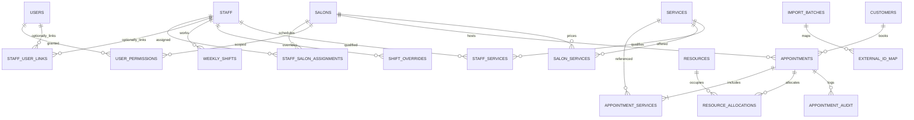

# Private Nail Salon Booking Calendar — Phase A Product & Technical Architecture

**Status:** Design specification only — no implementation or tests executed.  
**Date:** 31 October 2026  
**Basis:** The two user-provided documents `nail_salon_booking_blueprint(1).md` and `nail_salon_master_coding_prompt(1).md`, plus official source references listed at the end.

## 1. Executive architecture decision

Create one centrally hosted, staff-only scheduling web application for Jeannie Nagelstudio, Juliet – Salon de Beauté and a planned Heide branch. Support approximately 15–20 staff initially. All salons use one scheduling service and one PostgreSQL database. The app owns scheduling data; the frontend calendar is a replaceable visualization of authoritative backend state. Do **not** add online payments, POS, invoicing, payroll, inventory or a public booking website in V1.

**North-star experience:** Select an empty technician/time slot → customer search/new customer/walk-in → choose one or more services → review time and duration → Save. Target less than 15 seconds for routine returning-customer bookings. System safety wins over optimistic UI speed.

### Decisions and rationale

| Decision | Phase A recommendation | Rationale |
|---|---|---|
| Architecture | Modular monolith, not microservices | One team, three salons, lower operational complexity |
| Frontend | Next.js + React + TypeScript + Tailwind + shadcn/ui | Mature TypeScript ecosystem and UI building blocks |
| Calendar | **Not selected yet**; compare React Big Calendar vs DayPilot Lite in one measured spike | Free-edition iPad and horizontal-density risks |
| API/business logic | Server-only application services with validated request handlers | One authoritative availability engine, callable later by public widget |
| Database | PostgreSQL, Drizzle or Prisma for routine CRUD, explicit SQL migration for exclusion constraints | PostgreSQL protects exclusive resource allocations under concurrency |
| Auth | Maintained session-based auth, secure cookies, password reset, MFA option | Admin/reception staff logins without customer accounts |
| Live views | Durable DB event/outbox + server-sent events or WebSocket; polling fallback | Multiple receptionists need prompt refresh; database remains source of truth |
| Hosting | EU-region app and PostgreSQL with encrypted offsite backups | Control data and recurring expense; ensure recoverability |
| Booking time | UTC instants stored, Germany local dates rendered in `Europe/Berlin` | Unambiguous DST behavior |
| Initial public booking | Excluded; schema records booking source and supports later channel | Avoid integration complexity in V1 |

## 2. Product requirements and acceptance targets

### User roles

- **Owner:** All locations and full administration; can export customers and review audit history.
- **Manager:** Explicit assigned salons; local services, rotas, bookings, approved customer fields.
- **Receptionist:** Book/change/cancel within permitted salons and view operational customer data; no global auth settings.
- **Technician:** See own permitted calendar and minimal customer/service details; optionally mark arrived/completed; no arbitrary customer search/export by default.
- The **bookable staff identity** must not require a login account. One user account may be linked to a technician, but never by an assumed 1:1 rule.

### P0 — first internal usable release

1. Login, role and location authorization.
2. Salon selection; 20-employee day view and one-employee week view; 15-minute grid default.
3. Empty-slot creation, quick customer search/creation, walk-in entry, one or more ordered services.
4. Service price/duration per salon, employee qualifications, shift and absence logic.
5. Edit, cancel, drag between employee columns, resize with duration-change confirmation.
6. Transactional, database-enforced no-overlap, including cross-salon staff assignment.
7. Multi-user update/reload, conflict rollback, audit trail.
8. Nightly backups, tested recovery and secure export/import preview.

### P1 — after stable live internal operation

- Recurrence series and exceptions, detailed customer alerts/visit history, import execution with reconciliation, email notifications, reports, multi-phase treatment scheduling and explicit rooms/equipment.
- A separate public booking widget comes only after the internal system is proven and Treatwell strategy is resolved.

### Exclusions

No online payments, checkout, POS, financial ledger, invoice or VAT document generation, stock control, payroll, marketing campaigns or external salon accounts. Store *service price snapshot* for appointment context only, never imply it is cash collected.

## 3. User journeys and appointment lifecycle

### Ordinary booking

1. User opens a permitted salon and day, chooses a technician's empty time.
2. The quick sheet preloads salon, technician, local start time.
3. Search phone/name → select customer or quick-create a minimal new customer/walk-in.
4. Pick service(s) → derive price snapshots, qualified staff and sequential appointment length.
5. UI shows candidate availability, total duration and optional private notes.
6. Save sends an idempotent authenticated request. Server validates and commits all allocations atomically.
7. Calendar updates across clients; success message shows booking time and technician.
8. If conflict, show the conflicting person/time and retain the unsubmitted form.

### Reschedule

1. Drag booking to a new time/technician or edit details via sheet.
2. UI displays a tentative state without changing authoritative store.
3. Send appointment ID, expected version, requested assignments/time and idempotency key.
4. Transaction validates, reallocates and increments version; UI commits on success.
5. On HTTP 409, snap card back, load latest bookings and explain the issue.

### Status transitions

- `booked` → `confirmed` → `arrived` → `in_progress` → `completed`.
- `booked`/`confirmed` → `cancelled` or `no_show`; manager may correct status with a logged reason.
- Status is **not** a proxy for allocation occupancy: `completed` and `no_show` keep historical allocations, `cancelled` releases active allocations while retaining full appointment/audit records.
- Treatwell import records require `source` metadata but must not appear to be live-synced.

## 4. Calendar UI specification

### Desktop wireframe — representative (not copied from Salonized)

```text
┌───────────────┬────────────────────────────────────────────────────────────────────────┐
│ BRAND / SALON │ [<] 31.10.2026 [>] [Heute] [Tag|Woche] [Mitarbeiter ▾] [Suche] [+Termin]│
│               ├─────────┬────────────┬────────────┬────────────┬────────────┬─────────┤
│ Kalender      │ Uhrzeit │ Linh       │ Mai        │ Anna       │ Lisa       │  ...    │
│ Kunden        ├─────────┼────────────┼────────────┼────────────┼────────────┼─────────┤
│ Team          │ 10:00   │ Gel · A.   │            │ Maniküre   │            │         │
│ Services      │ 10:15   │ Rosa       │ Shellac    │ Julia      │            │         │
│ Einstellungen │ 10:30   │            │ Lena       │            │ Pediküre   │         │
│               │ 10:45   │            │            │            │ Mia        │         │
│ My account    │ 11:00   │ [+]        │ Pause /////│ [+]        │            │         │
└───────────────┴─────────┴────────────┴────────────┴────────────┴────────────┴─────────┘
                                   CLICK EMPTY SLOT → RIGHT HAND QUICK BOOKING SHEET
                        [Kunde suchen...........................] [Neu] [Laufkundschaft]
                        [Service wählen.........................] [+ weiterer Service]
                        [Mitarbeiter] [Start] [Dauer / Ende] [Notiz] [Termin speichern]
```

This is a conceptual wireframe. Production UI should prioritize column width and horizontal scrolling over shrinking 20 technician names into unreadable columns.

### Layout dimensions and visual behavior

- Collapsible sidebar about 220–240px wide; compact top toolbar; main area fills remaining viewport.
- Time ruler 64–76px; employee columns ideally about 150–200px on desktop, horizontally scrollable when necessary.
- Sticky technician headers and time ruler; vertical day-grid scroll independent of top navigation.
- Default interval 15 minutes; alternatives 5, 10, 20, 30 minutes. Show visible intervals clearly; internal appointment times can retain finer precision if imported.
- Standard salon day shown from opening to closing with sensible padding; grey outside roster, hatched absences and breaks, current-time marker.
- Pastel by service category; status via text/icon/stripe. High contrast and no color-only state differentiation.
- Cards show customer name consistent with privacy policy, treatment and time. Click opens details, not another page.
- Toolbar: location, date controls, Today, Tag/Woche, employee filter, name/phone search, +Termin, +Zeit blockieren.
- One-person **week** view: seven daily columns; not a 7 × 20 matrix.
- Desktop keyboard: `/` or Ctrl+K for customer lookup only when focus-safe; Escape closes sheet; Enter submits only valid forms; tab-order tested.
- Tablet: day-first staff selector, fewer visible columns, large tap targets, horizontal scroll, tap-based rescheduling fallback. No required hover action.
- Phone: single technician/day view, employee carousel/select, tap to open booking form; no requirement to show all 20 staff at once.
- Empty/loading/offline/error states must be designed, not improvised during coding.

### Quick-booking sheet

Prepopulate location, selected staff and start. Focus customer search. Show recent customer services and popular treatments in a later iteration. Service selection shows duration/price snapshot, computed end, qualified staff, note, final Save button. A busy slot shows a precise error without losing input. A walk-in requires only a minimal display name, if desired; never force a fabricated phone/email.

### Critical UX behavior

A dragged appointment is tentative until the server accepts it. If the server rejects the move because the employee is busy or absent, revert visual position and explain why. A resize affecting treatment length is an explicitly confirmed duration override; do not quietly rewrite service catalog durations. Search must honor salon/user access.

## 5. Calendar library decision matrix (31 October 2026)

| Criterion | DayPilot Lite resource calendar | React Big Calendar | Test needed |
|---|---|---|---|
| License | Apache 2.0, commercially usable | MIT, commercially usable | Check installed package/version notice |
| Vertical staff columns | Built in | Resource view available | 20-column day |
| Drag-and-drop across staff | Documented for Lite | Drag-and-drop addon + resources; confirm particular behavior | Cross-column move and event resize |
| Appointment resizing | Documented for Lite | Supported through drag/drop addon | Resize across intervals |
| iPad touch | **Resource Calendar lists touch under Pro, not Lite** | Touch handling exists but a September 2026 open bug concerns mixing touch/mouse inputs | Physical iPad/touch hybrid mandatory |
| Wide 20-staff day | Pro adds fixed-width wide-calendar and progressive rendering | CSS/layout tuning expected | Header stickiness, scrolling, 100–300 bookings |
| Themes and UI | CSS themes/custom content | CSS/Sass/custom event components | Design flexibility |
| Day + week views | Yes | Yes | Localization and DST |
| Cost for core features | Free with Lite limitations | Free | No hidden paid addon |

**Decision now:** Do not commit. First try React Big Calendar for potentially more adaptable touch workflows and DayPilot Lite for out-of-the-box resource UX. Select whichever **passes on real iPad + desktop**; if neither does, use tap-to-reschedule with a free library, consider a controlled custom day grid, or request explicit approval for a paid library. Do not silently add DayPilot Pro or FullCalendar Premium. FullCalendar's vertical resource view is premium and not covered by Standard MIT.

### Spike scorecard / gate

Pass/fail each library against: 20 columns; day view; individual week; desktop drag and resize; cross-staff move; iPad tap selection and drag or reliable tap-edit fallback; desktop scrolling and sticky headings; 200 sample appointments; safe rendering of long German service names; German locale; Safari/Chrome; DST weekend; keyboard usability. Record the actual installed library version and reproducible findings. No library choice is final until this gate passes.

## 6. Logical architecture

```text
Desktop / iPad / mobile browser
        |
   Next.js React shell (German UI)
   - Calendar adapter (replaceable)
   - Booking form / customers / employee roster / services
        |
   Validated authenticated API (Zod + role and salon policy)
        |
   Scheduling application service (ONE authority)
   - working hours + leave + eligibility + multiple services
   - allocation & reschedule transaction
   - appointment status, audit and idempotency
        |
   PostgreSQL
   - staff/resource allocation exclusion constraints
   - bookings, snapshots, staff shifts, customers, audit
   - outbox / change log
        |                             \
   encrypted backups/restore          SSE live updates + polling fallback
```

A paid product or public site must never be necessary for scheduling. Business rules must be independently testable without a browser or calendar component.

## 7. Data model / ERD

### Core relationships



### Tables and constraints

| Table | Important fields / rules |
|---|---|
| `salons` | ID, name, time zone, opening-hours settings, active status |
| `staff` | ID, name, active, color; not necessarily a user |
| `users` | ID, auth credentials/provider, active, MFA/session links |
| `staff_user_links` | optional staff ↔ user connection |
| `user_permissions` | user, role, salon; owner global policy only with deliberate role |
| `staff_salon_assignments` | staff, salon, active period; validates permitted scheduling |
| `weekly_shifts` | staff, salon, weekday, local time segments and effective dates |
| `shift_overrides` | staff, salon, date, override segments or closure, actor/reason |
| `time_blocks` | staff/resource, interval, break/leave/task, author/reason, scope |
| `customers` | name, normalized telephone/email, separate notes/alert access, retention fields |
| `service_categories`, `services` | category, service, active, base display info |
| `salon_services` | salon-specific service price, duration, active flag |
| `staff_services` | staff qualification, optional duration override |
| `appointments` | ID, salon, customer nullable, start/end UTC, status, source, version, notes, audit metadata |
| `appointment_services` | ordered service snapshots (name/price/duration), staff assignment, timing offsets |
| `resources` | one stable exclusive staff resource per real staff identity; later optional rooms/tools |
| `resource_allocations` | resource ID, UTC range, active, appointment/service/blocked-time owner; server-controlled writes |
| `appointment_audit` | actor, changes, time, source, request/correlation ID, reason |
| `idempotency_keys` | actor/route/key, request fingerprint, result and expiry to handle retries |
| `import_batches`, `external_id_map` | import file hash, source, mapping, original ID, reconciliation |
| `outbox_events` | durable appointment-change events for real-time consumers |

Important: staff used across two salons must refer to **one staff identity and one exclusive resource ID**, not two independent resources. Customer and service records may be centrally shared, while salon access and location-specific prices/appointments are scoped.

### Booking interval invariants

- Every occupied resource interval is a half-open time range: `[start_at, end_at)`. Adjacent 10:00–10:30 and 10:30–11:00 are allowed.
- Persist UTC timestamptz and validate `start_at < end_at`.
- For a given `resource_id`, active ranges must **never overlap**. Implement PostgreSQL GiST exclusion via `btree_gist` plus range-overlap operator. Make the constraint partial, applying to active allocations only.
- Absences/breaks that must block bookings occupy the same staff resource through `time_blocks` allocations; working hours remain a separate eligibility constraint.
- A multi-service visit creates the necessary individual staff/resource allocations atomically, **not** one coarse visit-length block if staff differ.
- Service title/price/duration snapshots are immutable historical facts after creation; explicit edits create audit events.
- Cancellation deactivates current allocations but retains the appointment and audit records.

## 8. Booking and conflict-prevention protocol

### Create request (conceptual transaction, not source code)

1. Authenticate, authorize the salon, check idempotency key and validate fields.
2. Resolve effective salon-specific service durations, employee eligibility and all occupied resource intervals.
3. Start a database transaction; lock affected resource/staff rows in deterministic sorted order, preventing concurrent schedule-rule edits from racing with bookings.
4. Under those locks, re-check employee location assignment, current shifts/overrides, breaks, absences and resource eligibility. All shift/absence changes must follow the same lock discipline.
5. Insert appointment, service snapshots, all allocations, audit record and an outbox change event atomically.
6. Database exclusion constraints reject any overlapping active resource intervals. On conflict, roll back **everything** and respond HTTP 409 with a readable explanation; never partially book one service of a combination.
7. Commit, return the new appointment and version. Dispatch change notifications after commit. On transient retry, use idempotency to prevent duplicates.

### Update / move / resize

- Require `expectedVersion`; if changed, return a stale-version 409 and canonical server state.
- Lock all currently and newly affected resources in canonical order, then validate and reallocate atomically.
- Moving across salons changes the salon only if the user has permission and staff is eligible there; cannot create simultaneous occupation elsewhere.
- A resize is either consistent with service model or a recorded authorized duration override.
- Persist audit diffs, not just overwrite an existing appointment.

### Date/time and DST

- Display local times `Europe/Berlin` but transmit UTC instants plus explicit display time zone where useful.
- When local input represents a nonexistent DST-gap time, reject with an explanation; ambiguous repeated wall-clock time must be disambiguated before saving.
- Calendar days are derived from local date boundaries, not 24-hour UTC additions. Test daylight-saving transition weekends and an appointment that crosses midnight.

## 9. API contract, error model and events

| Endpoint | Purpose | Important contract |
|---|---|---|
| `GET /api/calendar` | Range/day by permitted salon and staff filters | Scope by session and permission, not trusted ID alone |
| `GET /api/availability` | Candidate slots, plus reasons not available | Nonauthoritative preview; Save revalidates |
| `POST /api/appointments` | New visit | Idempotency key, salon/service/staff validation |
| `GET /api/appointments/{id}` | Booking detail | Redact disallowed fields |
| `PATCH /api/appointments/{id}` | Notes/status/snapshot edits | Expected version and audit |
| `POST /api/appointments/{id}/reschedule` | Move or resize | Atomic allocation replacement, HTTP 409 on conflict |
| `POST /api/appointments/{id}/cancel` | Cancel with reason | Release active allocations; retain history |
| `GET/POST /api/customers` | Search/create | No unrestricted sensitive note exposure |
| `GET/POST /api/services` | Catalog operations | Role and salon scope |
| `GET/POST /api/shifts` | Shift configuration | Manager/owner role and lock consistency |
| `GET/POST /api/time-blocks` | Break/absence blocking | Conflict-aware modifications |
| `POST /api/imports/preview` | Validate actual exports | No permanent write; secure temporary storage |
| `GET /api/calendar/changes` | SSE events or cursor polling | Scoped event payloads; no customer private details in notification event |

- Use 401 unauthenticated, 403 unauthorized, 404 hidden/not found, 409 booking/version conflict, 422 invalid request, 429 throttled, 5xx unexpected failures.
- Error responses include machine-readable `code`, safe human-readable German `message`, correlation/request ID, and for conflicts the affected interval/staff when permitted.
- Push only minimal event IDs and change versions to clients; clients re-fetch authoritative data.

## 10. Security, privacy and operations

- HTTPS/TLS; secure, HttpOnly, SameSite cookies; CSRF protection appropriate for session APIs; restricted admin exports; MFA for owner; short/rotated sessions as appropriate.
- Apply authorization in every server handler and export; test staff role cannot access other salons or arbitrary customer notes.
- Limit stored personal data: name and optional contact details for phone bookings, private notes only where needed. Avoid storing unnecessary health information or photos. Separate sensitive alerts and grant limited access.
- Review GDPR legal basis, retention, data-subject rights, privacy notices, processor agreements, and lawful customer data sharing if salons belong to separate legal entities.
- Use EU hosting and encrypted, independently stored backups. Define operational targets provisionally: recovery point **≤15 min**, recovery time **≤2 hours**; these are goals to validate, not guarantees. Plain nightly backups do **not** satisfy a 15-minute recovery-point objective; implement verified WAL/PITR or adjust targets.
- Restore backups to an isolated test instance and actually verify future bookings, customer records and authorization.
- Monitor uptime, failed jobs, errors and disk use; document paper/phone fallback and later reconciliation for internet outages.
- No customer data in GitHub, screenshots, app seed fixtures or debug logs; use 20 synthetic technicians and fictional customers for design spike.

## 11. Salonized migration / Treatwell cutover

**Source fact:** Salonized settings allow Lifetime Exports in XLS/CSV for Customer Database, Appointments, Deleted Appointments, Absences, Treatment Reports and more (Settings → General → Data Export). Source file formats and IDs are not known until an actual sample is supplied.

1. Export separately per salon or entire company as supported; store originals securely.
2. Inspect sample headers, separators, encoding, local/UTC times, event statuses and source identifiers before writing the importer.
3. Preview/dry run each import; report exact counts and unrecognized services/staff, invalid times, duplicate candidates and conflicting allocations.
4. Map old IDs to new canonical IDs and store per-source unique IDs/file hashes; re-importing identical rows must not duplicate records.
5. Start with fictitious test data and a nonauthoritative pilot calendar. Salonized remains source of truth until actual cutover.
6. Freeze or strictly coordinate edits for a short agreed operational cutover, export recent future bookings again, perform reconciliation and assign an employee to resolve exceptions.
7. Compare all future bookings by date, staff, service and customer. Treat discrepancies as go-live blockers.
8. Test return to Salonized as rollback before canceling any subscription.

**Treatwell limitation:** Salonized auto-populates Treatwell bookings through its own documented integration. No equally supported custom-app integration was established in this research. Avoid running independent calendars for live availability unless there is an approved supported sync procedure or a documented manual capacity reconciliation. Treatwell marketplace commissions are a distinct business expense from software subscription fees.

## 12. Operating costs and ownership

Infrastructure costs are small relative to engineering and support responsibility. Example current official 2026 Hetzner cloud price for Germany: CX33 starts **€8.49/month excluding VAT and public IPv4** (per June 2026 price adjustment). This is a component price, **not** a production all-in quote.

| Cost category | Planning allowance, not supplier quote |
|---|---|
| App hosting and database compute | ~€20–€70/month depending on topology and redundancy |
| Offsite backups/PITR storage, monitoring, domain | ~€10–€50/month |
| Email (Phase 2) | €0–€20+/month depending on volume and provider |
| Estimated small-business infrastructure range | Roughly **€30–€140/month**, excluding engineering, support and VAT differences |

Production setup may exceed this range with managed databases, stricter recovery requirements or external support. A self-hosted low-cost VPS can be cheap to rent but expensive to maintain. Do not promise savings without entering actual Salonized/Treatwell invoices, estimated build hours and annual maintenance work.

Break-even calculation: `initial build + yearly support/hosting` compared against `subscriptions actually eliminated`, **excluding Treatwell acquisition commissions unless customer acquisition also moves away from the marketplace**.

## 13. Risk register

| Risk | Severity | Mitigation / go-live gate |
|---|---|---|
| No supported custom Treatwell synchronization | Critical | Supported workflow agreement or remove channel reliance before cutover |
| Concurrent double bookings | Critical | DB exclusion constraint + transaction tests, 2+ parallel request race |
| Multi-salon duplicate staff identities | High | Canonical staff merge and one resource ID across locations |
| Free calendar mobile limitations | High | Physical iPad spike; tap-to-edit fallback or explicit paid decision |
| Missing historical data or import errors | High | Dry run, reconciliation and rollback logs |
| Internet downtime / untested backups | High | Restore test, downtime playbook and measured RPO/RTO |
| Customer data exposure | High | Scoped access and export controls, GDPR review |
| DST/off-by-one-day scheduling | High | UTC storage, local-date query tests, DST cases |
| Overcomplex Phase 1 | Medium | Feature gate: one real appointment flow before reports/marketing |

## 14. Acceptance test matrix

| Scenario | Expected result |
|---|---|
| Two receptionists book same staff for same time simultaneously | One commits, one gets 409; exactly one active allocation |
| Employee booked in Hamburg and Heide at same time | Second booking rejected even across salon IDs |
| Touch move into occupied slot | No persisted change; card returns to original location; German error |
| Appointment with two sequential services/technicians | Separate accurate allocation windows and accurate end time |
| Break/absence/holiday/unqualified staff | Booking blocked unless explicitly permitted, audited outside-hours override applies (never exclusive collision override) |
| Cancel booking | Active allocation released, history and snapshots remain |
| Two tabs editing one booking | Older version rejected without silent overwrite |
| Repeat same import | No new duplicates; reconciliation report consistent |
| German daylight-saving gap or ambiguous hour | Validated/disambiguated; no impossible UTC interval saved |
| Technician login requests owner-only endpoint | 403 or safe 404; no sensitive data returned |
| Restore snapshot + WAL to isolated test environment | Future appointments and customers present, validated in restore report |
| 20 staff and ~200 synthetic appointments | Columns remain readable and interactions acceptable on desktop; iPad fallback usable |

## 15. Milestones with explicit gates

| Stage | Deliverable | Exit criterion |
|---|---|---|
| A — **this document** | Product, architecture, UX, ERD, API, risks, plan | Owner approves assumptions and prototype tests |
| B — library evaluation spike | Two **synthetic** UI prototypes, DayPilot vs RBC, no production data | One approach passes desktop/iPad tests without unapproved paid license |
| C — first vertical slice | Real auth, database, one salon, one booking UI/API, active allocation | Parallel-booking test proves only one success |
| D — operating MVP | Multiple salons, roles, shifts, multi-service, cancellations, reschedules, customer list | Staff workflow and permission tests pass |
| E — production readiness | Import, monitoring, backups/restore, pilot, cutover | Zero unreconciled future bookings and approved Treatwell plan |
| F — optional | Recurrence, complex treatment phases, email, reporting, own widget | Prioritize from real salon feedback |

### The first smallest coding task (AFTER approval, not executed)

Build two isolated, browser-runnable, fake-data resource calendars with the same fixture of **20 technicians**, **about 200 appointments**, a long German salon day, breaks and one absence. A single salon/day view and individual employee/week view only. No login, no database, no real customer data.

For each library implement/test in the spike: click free slot → opening appointment editor with prefilled technician/time; drag time; cross-column move; resize; scroll with sticky headings; mobile/iPad tap access and non-drag reschedule fallback; German formatting; current-day indicator; events with long names. Record browser/device, library versions, success/failure and time to book a test appointment. The spike may use local state only and must be clearly labeled as a prototype.

**Gate:** We do not proceed with the final UI library choice until both candidates have a reproducible comparison and an iPad-safe workflow.

## 16. Open decisions that matter before production

1. Treatwell: will bookings continue flowing through Treatwell after replacing Salonized, and which contractual/integration options exist?
2. Hardware: which specific iPads and desktop browsers are used daily? Are there touch-enabled Windows PCs?
3. Employees/services: do customers ever book two technicians simultaneously or treatments with an idle/processing interval?
4. Legal structure: are all locations under one data controller/legal entity, and can customer files be shared among branches?
5. Retention and notification: what data can be migrated, who should see customer alerts, and which communications should be automatic?
6. Recovery: is up to 15 minutes of potential booking loss unacceptable, or is a longer recovery window affordable?

These decisions do not block the **synthetic calendar prototype**, but several block production cutover.

## 17. Sources researched on 31 October 2026

- Official Salonized booking workflow: https://help.salonized.com/en/articles/572355-schedule-appointments
- German Salonized booking details: https://help.salonized.com/de/articles/572355-termine-einplanen
- Calendar settings: https://help.salonized.com/en/articles/572381-how-do-i-manage-my-calendar-and-appointment-settings
- Service phases, buffers and resources: https://help.salonized.com/en/articles/572358-how-do-i-manage-categories-and-services-on-salonized
- Cross-location staff: https://help.salonized.com/en/articles/4448922-how-can-i-add-and-manage-team-members-in-several-locations
- Central/multi-location records: https://help.salonized.com/en/articles/3721799-multiple-locations-in-one-account
- Treatwell integration: https://help.salonized.com/en/articles/6417703-how-does-the-treatwell-integration-work-in-salonized
- Export capabilities: https://help.salonized.com/en/articles/573326-how-do-i-export-data-for-my-accounting
- DayPilot Lite vs Pro per React view: https://www.daypilot.org/react/
- DayPilot React calendar documentation: https://doc.daypilot.org/calendar/react/
- React Big Calendar source/license: https://github.com/bigcalendar/react-big-calendar
- RBC mixed mouse/touch issue: https://github.com/bigcalendar/react-big-calendar/issues/2817
- FullCalendar commercial resource licensing: https://fullcalendar.io/pricing
- Hetzner June 2026 cloud prices: https://docs.hetzner.com/general/infrastructure-and-availability/price-adjustment/

**Evidence boundary:** These links document vendor products; they do not establish that a candidate calendar library passed any actual tests for this application. No custom application has been implemented or deployed in this Phase A deliverable.
