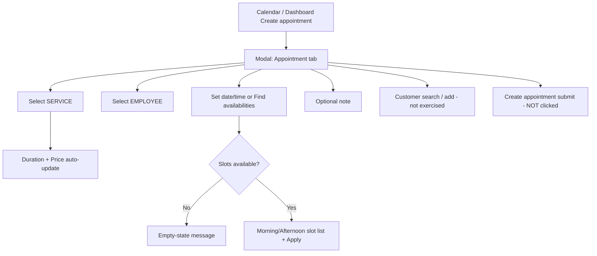
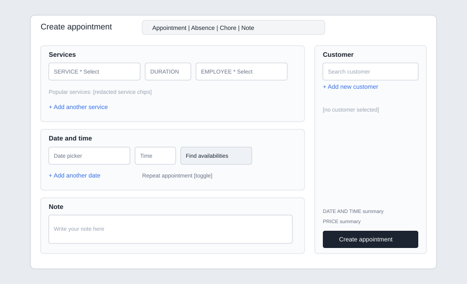

# Discovery 01 — Create Appointment

| Field | Value |
|---|---|
| Status | Awaiting Owner approval |
| Observed account | Jeannie Nagelstudio (Salonized) |
| Observed locale UI | English UI labels in this session |
| Observation date | 2026-11-08 |
| Safety | Read-only exploration. No appointment was saved. No customer records were searched or exported. No SalonFlow application source was modified. |
| Evidence labels | **OBSERVED** live UI · **DOCUMENTED** project docs · **PROPOSED** SalonFlow target · **UNVERIFIED** not safely confirmed |

## 1. Entry points

### 1.1 From Calendar (**OBSERVED**)

1. Opened sidebar **Calendar** → `/calendar`.
2. Clicked / navigated to **Create appointment** (primary header CTA).
3. URL became `/calendar/create-event/appointment`.
4. A modal overlay opened on top of the week calendar.

Also observed on Dashboard (**OBSERVED**):

- Center CTA **Create appointment**
- Quick start **Appointment**
- Both route to the same create-event appointment URL pattern

### 1.2 Alternate entry from empty slot (**UNVERIFIED**)

Not clicked during this pass (risk of accidental persistence / side effects). Project docs expect empty-slot create with prefilled staff/date/time (**DOCUMENTED** FLOW-03 / SF-018).

## 2. Calendar layout context (**OBSERVED**)

Before opening create:

- FullCalendar-style week grid, Monday-first (`Mon 2-11` … `Sun 8`) for week **2–8 Nov 2026** / **W 45**.
- Toolbar: **Today**, view selector **Week**, date-range navigator (`2 - 8 Nov 2026`), **Employees** filter, **Show all**, calendar search icon.
- Time axis in **15-minute** increments from early morning through late evening (sampled `08:00`–`22:45`).
- Non-working regions shown with hatched / greyed cells (notably evening and Sunday in this account).
- All-day row includes **Waiting list** count chips per day.
- Appointment blocks show time + customer + service; absence-style blocks show staff unavailability (“is absent” / “is not available”).
- Current-time indicator line present.

**PII note:** Live calendar contained real customer names. Those names are **not** reproduced here. No unredacted calendar screenshot was committed.

## 3. Create Appointment interface — step by step

### Step A — Open modal (**OBSERVED**)

**Clicked / navigated:** Create appointment  
**Appears:** Modal titled **Create appointment** over calendar.

Header tabs (event types):

| Tab | State in this pass |
|---|---|
| Appointment | Active (**OBSERVED**) |
| Absence | Visible, not deep-inspected (**UNVERIFIED** behavior) |
| Chore | Visible, not deep-inspected (**UNVERIFIED**) |
| Note | Visible, not deep-inspected (**UNVERIFIED**) |

Chrome: expand control + close (X). Escape dismissed the form without save (**OBSERVED**).

### Step B — Services block (**OBSERVED**)

Fields:

| Field | Required | Default | Notes |
|---|---|---|---|
| SERVICE | Yes (`*`) | `Select` | Searchable dropdown (`Search…`) |
| DURATION | Editable textbox | `60 min` before service chosen | Auto-updates after service selection |
| EMPLOYEE | Yes (`*`) | `Select` | Searchable staff list |

Additional controls:

- **Popular services** chips (quick-add shortcuts; service names are catalog data, not customers)
- **+ Add another service** (multi-service line support)

#### Service dropdown (**OBSERVED**)

Opened SERVICE select. Behavior:

- Searchable list grouped by uppercase categories
- Each option shows **service name + price (€)**
- Approx. **105** priced options visible in list text
- Categories observed:

1. MANIKÜRE  
2. PEDIKÜRE  
3. GEL NAGELMODELLAGE (VEGAN)  
4. ACRYL/PULVER NAGELMODELLAGE  
5. BIAB-GEL NAGELMODELLAGE (VEGAN, HEMA-FREE)  
6. GEL-X NAILS EXTENSION  
7. ZEHENMODELLAGE MIT GEL/PULVER/BIAB  
8. NUR SHELLAC - JUST COLOR ME! (VORHER SHELLAC)  
9. PFLEGE BEHANDLUNG (IBX AUFBAUKUR)  
10. ENTFERNUNG HÄNDE/FÜSSE - REMOVAL NAILS HANDS/FEET  
11. NAILS DESIGN - EXTRAS  
12. AZUBIS BEHANDLUNG  

#### Service selection side effects (**OBSERVED**)

Selected catalog item: `Spa Maniküre Basic - ohne Farbe` (`€ 19,00`).

Immediate UI updates:

- Duration changed `60 min` → **`20 min`**
- Summary **PRICE** changed `€ 0,00` → **`€ 19,00`**
- Employee remained unselected until chosen

### Step C — Employee selection (**OBSERVED**)

Opened EMPLOYEE select. Searchable list of bookable staff first names (staff roster, not customers), including status icons (briefcase / warning) on some rows.

Observed staff options (first names only): Jennifer, Lena, Linda, Emma, Julia, Inna, David, Tony, Mia, Ben, Tommy.

Selected **Jennifer** in-form only (not saved).

### Step D — Date / time (**OBSERVED**)

| Control | Observed value / behavior |
|---|---|
| Date picker | Defaulted to current calendar context day: `Sun, Nov 08, 2026` |
| Time field | Default `16:00` (editable textbox) |
| Find availabilities | Opens secondary **Availabilities** modal |
| + Add another date | Present (multi-date / multi-visit UI affordance) |
| Repeat appointment | Toggle + helper text “Repeat this appointment at a regular interval.” (off by default) |

Right-rail summary mirrors date/time + price.

### Step E — Find availabilities (**OBSERVED**)

Clicked **Find availabilities** after service + employee were filled.

Secondary modal **Availabilities**:

- Month calendar (**November 2026**)
- For **Sun 8 Nov**: message **“There isn't any time slot available for this date.”**
- After choosing **Mon 9 Nov** (inspection only): slot groups appeared  
  - Morning: `10:00`  
  - Afternoon: `12:45`, `14:15`, `16:00`, `17:30`  
- Footer action **Apply** present

**Did not click Apply** (avoids writing chosen slot back into a near-save state). Closed with Escape.

Interpretation (**PROPOSED** / partially **OBSERVED**): availability depends on employee working hours, absences, existing appointments, and likely salon opening hours. Sunday empty slots align with hatched non-working Sunday on calendar.

### Step F — Note (**OBSERVED**)

Textarea placeholder: `Write your note here.` Optional. Not filled.

### Step G — Customer panel (**OBSERVED** UI chrome only)

Right column:

- Header **Customer**
- Search input placeholder **Search customer**
- Link **+ Add new customer**
- Empty state when no customer selected

**Not performed:** typing into customer search (would retrieve personal customer records).  
**Not performed:** Add new customer (would create a business record).

Customer required-for-save rule (**UNVERIFIED** in this pass — Create was never submitted). Project expectation is customer search/create inside booking (**DOCUMENTED** SF-018 / SF-020 / FLOW-03).

### Step H — Primary submit (**NOT EXECUTED**)

Bottom-right primary button **Create appointment** was **not** clicked.

## 4. Behavioral summary



### Interface behavior highlights (**OBSERVED**)

1. Create is a **modal route** over calendar, not a separate full-page form.
2. Same modal shell hosts Appointment / Absence / Chore / Note tabs.
3. Service catalog is categorized, searchable, priced.
4. Duration defaults then **overrides from selected service**.
5. Price summary updates from selected service(s).
6. Employee picker is independent but required (`*`).
7. Availability helper is a nested modal with date navigation + slot buckets + Apply.
8. Multi-service and multi-date affordances exist before save.
9. Escape closes without persistence (at least for unsaved draft explored here).

## 5. Dependencies

| Dependency | Role in Create Appointment | Evidence |
|---|---|---|
| Employees / bookable staff | Required assignee; availability scoped to selected staff | **OBSERVED** |
| Services (+ categories, duration, price) | Required service line; drives duration/price | **OBSERVED** |
| Working hours / timetable / absences | Constrain Find availabilities + hatched calendar regions | **OBSERVED** (effects) / exact config screens **UNVERIFIED** this pass |
| Customers | Search / create in right rail before linking | UI **OBSERVED**; retrieval **intentionally skipped** |
| Existing appointments | Compete for slots; appear on calendar behind modal | **OBSERVED** on calendar (content redacted) |
| Salon / location context | URL includes company/location ids; multi-location rules not exercised | Path **OBSERVED**; cross-salon behavior **UNVERIFIED** |

## 6. Expected SalonFlow functionality

Mapped to existing contracts (**DOCUMENTED** → **PROPOSED** implementation target):

| SalonFlow target | Source | Notes from this discovery |
|---|---|---|
| Quick-create sheet / modal over calendar | FLOW-03, M09, SF-018 | Match Appointment event-type entry; German UI later |
| Server-authoritative booking write | AGENTS.md, M08, SF-023 | UI must never authorize availability alone |
| Service selection with duration/price snapshot | SF-015, SF-016, SF-021 | Salonized auto-fills duration/price on select |
| Staff eligibility + hours/absence aware slots | SF-007–SF-011, SF-017 | Find availabilities empty on closed/unavailable day |
| Customer search + optional in-flow create | SF-018, SF-020 | Inspected chrome only |
| Multi-service lines | SF-021 | `+ Add another service` present |
| Optional note | SF-029 | Present; blocking rules **UNVERIFIED** |
| Recurring appointments | later / SF backlog | Toggle present; recurrence editor **UNVERIFIED** |
| German locale (`de-DE`, `Europe/Berlin`, EUR, 24h) | AGENTS.md, SF-041 | This Salonized session was English-labeled; SalonFlow still ships German first |

Out of scope for SalonFlow V1 (hard constraint): POS, online payments, invoices, inventory, payroll.

## 7. Visual references (redacted)

Unredacted Salonized screenshots were **not** committed (calendar background contains personal customer data).

Redacted schematic of the create modal:



### Redacted textual wireframe (**OBSERVED**)

```text
+------------------------------------------------------------------+
| Create appointment     [Appointment|Absence|Chore|Note]     [X] |
+-----------------------------------------------+------------------+
| Services                                      | Customer         |
| SERVICE* [Select/search] DURATION EMPLOYEE*   | [Search customer]|
| Popular services: [chips]                     | + Add new customer|
| + Add another service                         |                  |
|-----------------------------------------------|                  |
| Date and time                                 |                  |
| [Date] [Time] [Find availabilities]           | DATE AND TIME    |
| + Add another date                            | PRICE            |
| Repeat appointment [toggle]                   | [Create appointment]|
|-----------------------------------------------|                  |
| Note                                          |                  |
| [Write your note here]                        |                  |
+-----------------------------------------------+------------------+
```

### Availabilities sub-modal (**OBSERVED**, redacted)

```text
+--------------------------------------+
| Availabilities                   [X] |
| November 2026 calendar               |
| selected day highlight               |
| (closed day) "There isn't any time   |
|  slot available for this date."      |
| (open day) Morning / Afternoon slots |
|                            [Apply]   |
+--------------------------------------+
```

## 8. What could not be safely verified

| Item | Why |
|---|---|
| Successful save / calendar persistence | Would create a live appointment |
| Validation errors on incomplete submit | Would require clicking Create |
| Whether customer is mandatory | No submit attempted |
| Customer search ranking / history / alerts | Would load personal records |
| + Add new customer form fields | Would risk creating a customer |
| Apply slot from Availabilities | Avoided near-save state mutation |
| Empty-slot click prefills | Not clicked |
| Drag-create / double-click create | Not tested |
| Absence / Chore / Note tab forms | Tabs seen only |
| Repeat appointment recurrence editor | Toggle seen only |
| Multi-service duration sum / buffers | Only single service selected |
| Multi-date appointment semantics | Link seen only |
| Conflict message on overlapping save | Requires save |
| Notifications / messages on create | Forbidden / not triggered |
| German UI string set in Salonized | Session was English |
| Exact working-hour source for Sunday closure | Config screens not opened this pass |

## 9. Interaction log (this session)

1. Dashboard authenticated session confirmed.  
2. Opened Calendar week view.  
3. Opened Create appointment modal.  
4. Opened SERVICE dropdown; listed categories/options.  
5. Selected one service (form only).  
6. Opened EMPLOYEE dropdown; selected one employee (form only).  
7. Opened Find availabilities; inspected empty Sunday + slotted weekday; closed without Apply.  
8. Focused customer search chrome without querying.  
9. Dismissed modal via Escape — **no save**.

## 10. Approval ask

Please review this discovery note and approve or request corrections before the next Salonized workflow discovery task.
