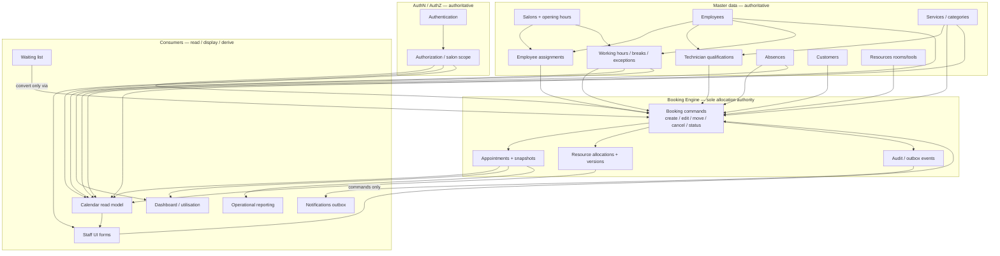

# Application Dependency Graph

| Field | Value |
|---|---|
| Purpose | Map authoritative vs consuming modules for SalonFlow implementation |
| Governing architecture | Master Architecture V2 — **Booking Engine is the sole authority for booking allocation changes** |
| Observation basis | Salonized UI discovery 2026-11-08 + Help IDs S01–S31 + SF-001–SF-048 |
| Label rule | OBSERVED / DOCUMENTED / PROPOSED / UNVERIFIED — proposed DB/API shapes are **SalonFlow**, not claimed Salonized internals |

## 1. Ownership summary (**PROPOSED** SalonFlow)

| Domain | Owns (authoritative write) | Consumed by | Must not write allocations |
|---|---|---|---|
| Authentication | sessions, credentials | all modules | — |
| Authorization / RBAC | roles, salon scopes | all APIs, SSE/feeds, exports | — |
| Salons | salon identity, opening hours defaults | staff hours inherit, calendar context, booking validation | appointments |
| Employees (staff) | staff identity, color, active flag | calendar columns, pickers, timetable | appointments |
| Employee assignments | staff↔salon membership | calendar filter, booking eligibility | appointments |
| Technician qualifications | staff↔service eligibility | booking form, availability candidates | appointments |
| Working hours / shifts | staff shifts, breaks, exceptions | availability, calendar hatching | appointments |
| Absences | absence interval **facts** (staff/company/resource) | availability, calendar blocks | appointments; must not INSERT allocations — publish to scheduling writer; Flow D commit gate |
| Services / categories | catalog name, duration, price, active | booking form, colors, reports | appointment *snapshots* after book |
| Customers | customer profile | booking link, search, CRM | appointments |
| **Booking / Scheduling writer** | appointments, service-line snapshots, **all exclusive `resource_allocations`** (appointments, blocking chores, block-backed absences), versions, cancel/no-show status, audit | calendar, dashboard, notifications, reports, waitlist convert | — |
| Resources (rooms/tools) | resource **identity** only (P2 attachment) | booking allocations when required | appointments / allocations without engine |
| Calendar (read model) | display preferences only (interval, color mode) | staff UI | allocations |
| Notifications outbox | queued transactional messages | delivery workers | invent bookings |
| Reporting / dashboard | none (derived reads) | managers | invent metrics |
| Waiting list | waitlist entries | marketing/calendar counts | convert without Booking Engine |
| Import staging | external ID maps | Booking Engine on commit | bypass engine |

## 2. Mermaid dependency graph

**Read rule:** arrows mean “feeds / constrains”. UI never authorizes availability; Booking Engine re-validates on write (**PROPOSED**, Master Architecture).

## 3. Upstream prerequisites by feature family

| Feature family | Must already exist | Evidence |
|---|---|---|
| Book employee | Salon (+ optional assignment) | **DOCUMENTED** S01 · SF-001 |
| Show staff on calendar | Active assignment + (hours or explicit unavailability state) | **DOCUMENTED** FLOW-01 · staff list **OBSERVED** |
| Offer service in create form | Active service (+ qualification if enforced) | Dropdown **OBSERVED** · SF-015/017 |
| Find availabilities slots | Employee + service duration + hours − absences − allocations | Empty Sunday **OBSERVED** · exact formula **PROPOSED** |
| Create appointment | AuthZ, salon, staff, service; customer optional for walk-in | Walk-in copy **OBSERVED** · SF-018/022 |
| Convert waitlist | Waitlist entry + Booking Engine success | SF-037 **PROPOSED** · convert UI **UNVERIFIED** |
| Send confirmation | Successful booking commit + notification settings | Confirmations in message log **OBSERVED** · SF-043 |

## 4. Entity lifecycle matrix (SalonFlow target)

### 4.1 Employee

| Stage | Behavior | Cross-effects | Evidence |
|---|---|---|---|
| Create | Persist staff resource; optional assignments; not auto-login | Calendar/timetable/picker | SF-001 · **DOCUMENTED** S01 · list **OBSERVED** |
| Read | List/admin + calendar headers | — | **OBSERVED** |
| Update name/color | Display updates; appointment identity unchanged | Calendar cards | SF-003 |
| Assign/reassign salon | Appear only where assigned | Other salon calendars | SF-005/006 · multi-loc **UNVERIFIED** live |
| Deactivate | Block new bookings; warn on future appointments; keep history | Availability, create form | SF-004 **PROPOSED** safety · Salonized delete behavior **UNVERIFIED** |
| Delete | Prefer archive over hard delete | SF-042 | **PROPOSED** |

### 4.2 Salon

| Stage | Behavior | Cross-effects | Evidence |
|---|---|---|---|
| Create | Empty calendar context + settings | Staff must be assigned later | SF-014 · **DOCUMENTED** S07 |
| Update opening hours | Inherited staff hours + availability recompute | Calendar hatching, Find availabilities | SF-007 · hours **OBSERVED** |
| Archive | Stop new ops; retain history | — | **PROPOSED** |

### 4.3 Service

| Stage | Behavior | Cross-effects | Evidence |
|---|---|---|---|
| Create | Category + duration + price | Appears in booking dropdown | SF-015 · **OBSERVED** |
| Update duration/price | Future bookings only; snapshots frozen | Create form defaults | SF-016 · duration auto-fill **OBSERVED** |
| Change eligibility | Filter staff candidates | Create form employee list | SF-017 · filtering **UNVERIFIED** live |
| Deactivate | Hide from new booking; history readable | SF-042 | **PROPOSED** |
| Packages | Create Package action exists | Booking package expansion | Action **OBSERVED** · expansion **UNVERIFIED** |

### 4.4 Customer

| Stage | Behavior | Cross-effects | Evidence |
|---|---|---|---|
| Create | Standalone or in-booking | Search index | SF-020 · activity log **OBSERVED** |
| Read/search | List + booking search | — | List chrome **OBSERVED** |
| Update | Profile fields | Future bookings display | **DOCUMENTED** S16 |
| Merge duplicates | Preserve appointment links | SF-036 | **DOCUMENTED** S17 · UI **UNVERIFIED** |
| Archive | Hide from default search; history intact | SF-042 | **PROPOSED** |

### 4.5 Appointment

| Stage | Behavior | Cross-effects | Evidence |
|---|---|---|---|
| Create | Engine validates + allocates + audits | Calendar, dashboard, optional messages | Create UI **OBSERVED**; save not executed · SF-022 |
| Read | Detail + history | — | Detail **OBSERVED** |
| Update / move | Versioned; re-allocate | Calendar refresh | Edit sheet **OBSERVED** · SF-024/048 |
| Status / no-show | Explicit transitions; **retain historical occupancy** unless audited correction (Architecture Flow C) | CRM indicators, optional email prompt | Actions **OBSERVED** · SF-026/027 · occupancy **PROPOSED** from Architecture |
| Cancel | Soft-cancel; free future slot; keep row/audit; optional reason (Flow C) | Availability, dashboard | Delete/cancel action **OBSERVED**; not clicked · SF-025 |
| Recurring | Bounded series | Collision preview | Toggle **OBSERVED** · SF-032/033 |

### 4.6 Shifts / working hours

| Stage | Behavior | Cross-effects | Evidence |
|---|---|---|---|
| Create/update | Inherit or manual; exceptions one-day vs future | Availability, hatching | Timetable **OBSERVED** · SF-007–009 |
| Breaks | Gap not bookable | SF-010 | **DOCUMENTED** S04 · UI edit **UNVERIFIED** |
| Change after bookings exist | Flow D: impact analysis + same locks; resolve/policy **before** commit; never silent delete | SF-046 | **PROPOSED** Architecture · **UNVERIFIED** Salonized |

### 4.7 Absences

| Stage | Behavior | Cross-effects | Evidence |
|---|---|---|---|
| Create | Flow D gate; block new slots; surface overlaps; allocations via scheduling writer | Calendar blocks | Absences page **OBSERVED** · SF-011/012/046 |
| Update/delete | Recalc availability; retain appointment rows | — | **PROPOSED** · live edit **UNVERIFIED** |
| National holidays | Company-wide unavailable days | Absences list **OBSERVED** | |

## 5. Edge-case dependency outcomes (**PROPOSED** unless noted)

| Scenario | Required SalonFlow outcome | Linked rules / tests | Live status |
|---|---|---|---|
| Two receptionists overlapping book | One commit, one 409; loser keeps form | SF-023 · IT-03/IT-06 | **UNVERIFIED** on Salonized |
| Technician in two salons | One identity; no overlapping occupancy | SF-013 · IT-03 | **DOCUMENTED** S06 · **UNVERIFIED** second location UI |
| Hours change with future appointments | Availability updates; appointments remain until rescheduled | SF-007/046 | **UNVERIFIED** |
| Absence over existing appointment | Retained appointments + conflict list; commit gated (Flow D) | SF-011/046 · IT-12 | **UNVERIFIED** create |
| Service deactivated after booked | History shows snapshot; no new selects | SF-016/042 | **UNVERIFIED** |
| Duration change after booked | Old snapshot kept; new bookings use new duration | SF-016 · IT-05 | **UNVERIFIED** edit |
| Deactivate technician with future bookings | Warn + block new; no silent wipe | SF-004/006 | **PROPOSED** |
| Multi-service / multi-tech lines | Ordered snapshots + allocations | SF-021 | Multi-service link **OBSERVED** |
| Duplicate customers | Controlled merge | SF-036 | **DOCUMENTED** S17 |
| Concurrent appointment edits | Version 409 | SF-048 · IT-08 | **UNVERIFIED** live |
| Refresh during unsaved booking | Client draft lost unless local draft (**PROPOSED** optional); server unchanged | — | **UNVERIFIED** |
| Network fail after Save | Idempotent retry | SF-047 · IT-06 | **PROPOSED** |
| Berlin DST | Persist UTC; reject nonexistent spring times | SF-041 · IT-16 | **PROPOSED** |
| Salonized import | Idempotent external IDs | SF-040 · IT-14 | Export UI **OBSERVED**; import **UNVERIFIED** |
| Treatwell / online channel | Still through Booking Engine validation | Online settings **OBSERVED** · payments **OUT** | |

## 6. Real-time & reporting consumers

| Event | Who must see update | Channel (**PROPOSED**) | Metrics affected |
|---|---|---|---|
| Appointment create/edit/cancel | Authorized salon viewers | DB outbox → SSE/poll (M12) · SF-038 | Dashboard utilisation, today list · SF-045/039 |
| Staff/hours/absence change | Same | refresh availability + calendar | Who’s working |
| Permission change | Immediate API denial | SF-044 · IT-15 | exports/feeds |
| Notification settings | Outbox scheduling only after commit | SF-043 | message log |

## 7. Explicit non-goals

- Do not treat Salonized Register/Products/VAT reports as Booking Engine inputs.
- Do not invent Salonized table schemas from UI.
- Do not let Calendar UI, Waitlist, or Online widget allocate resources directly.
